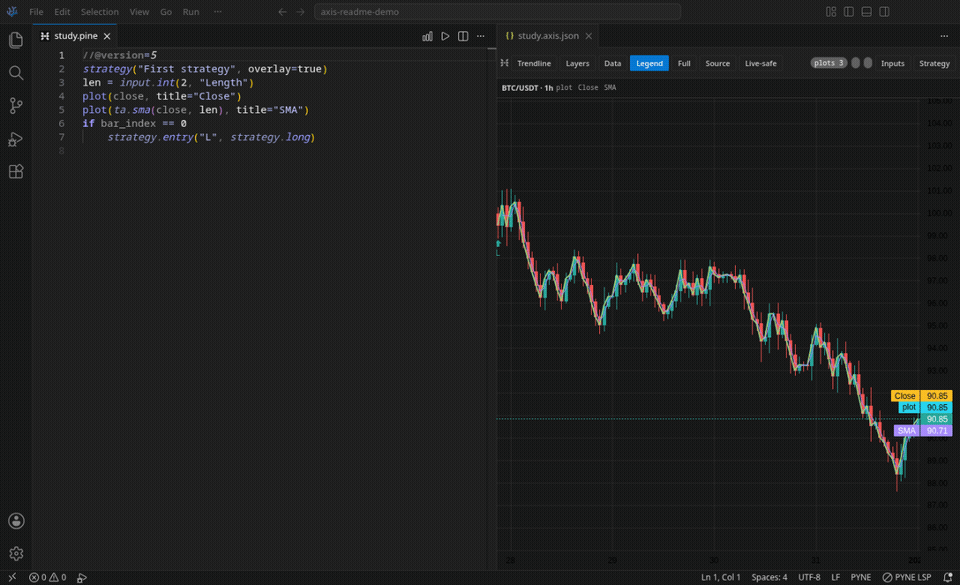
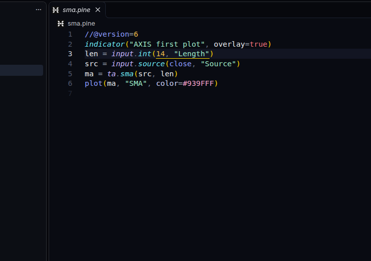
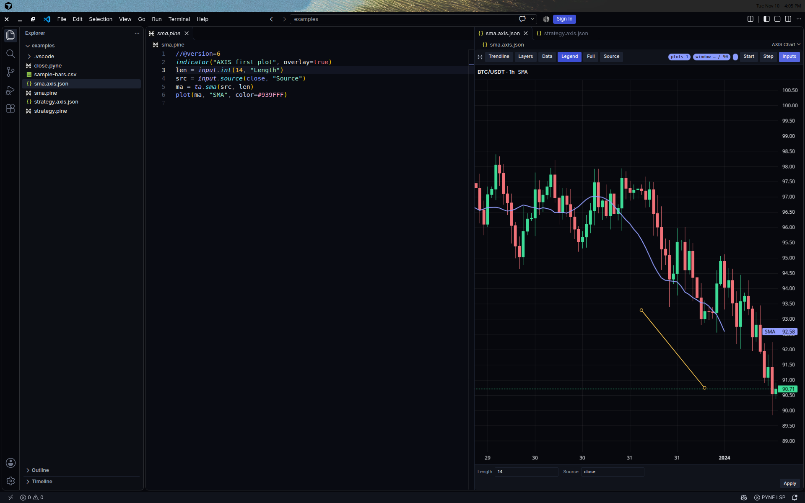
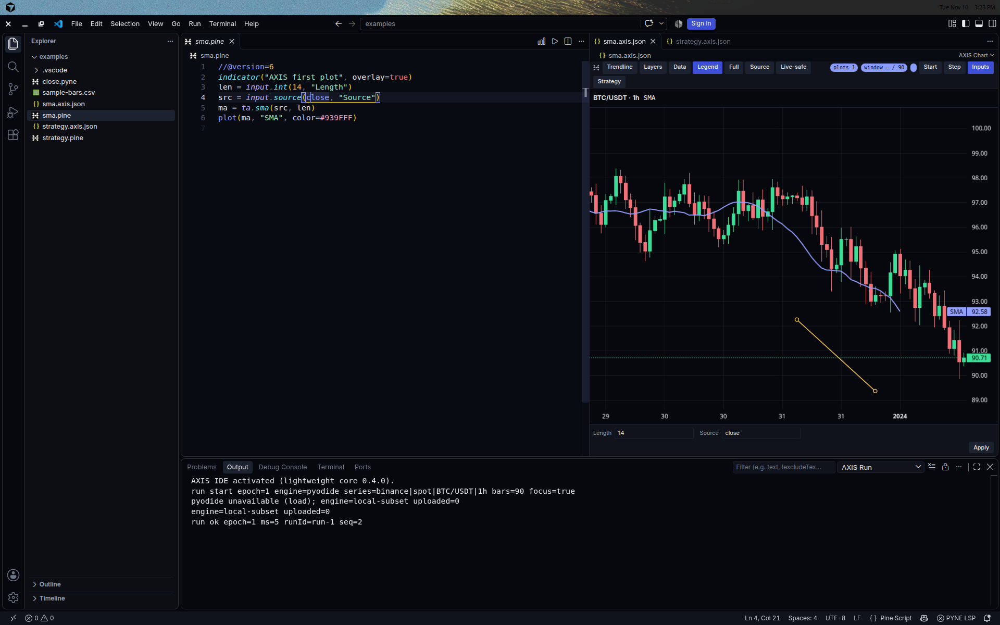
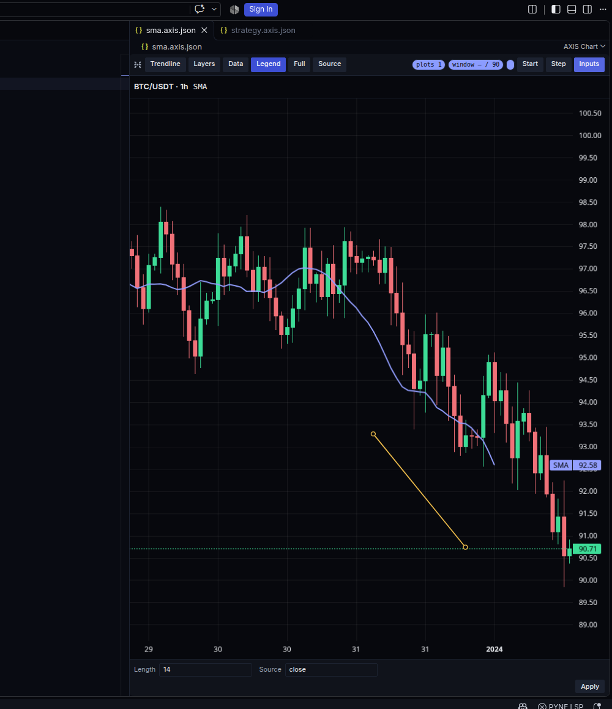
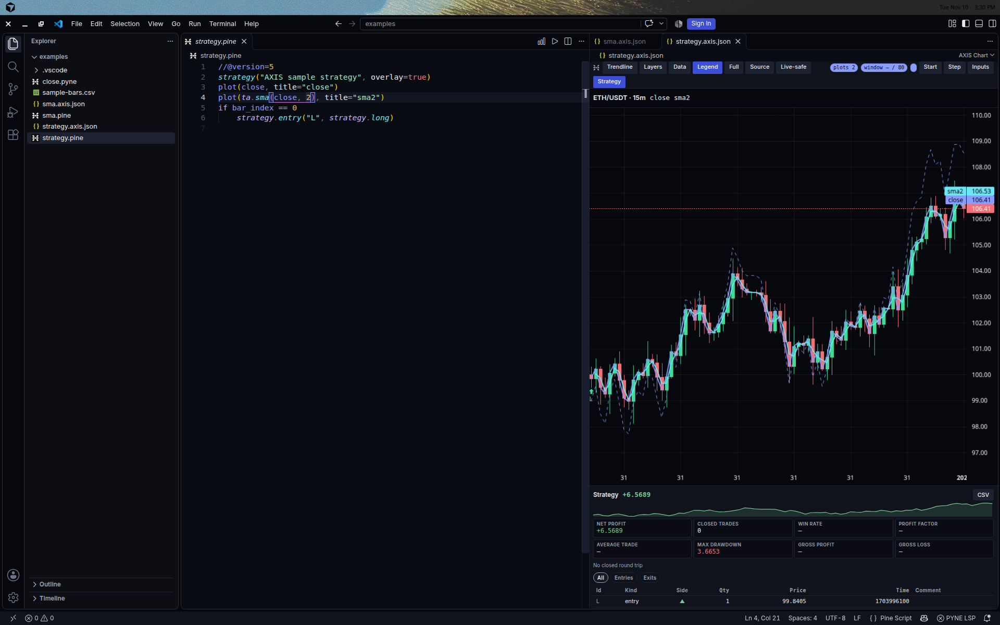
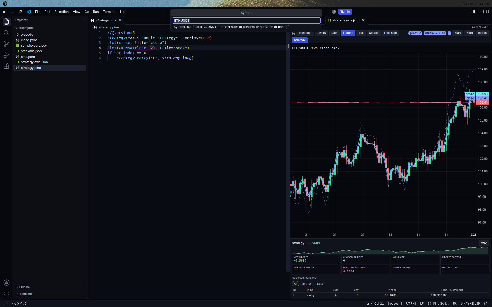
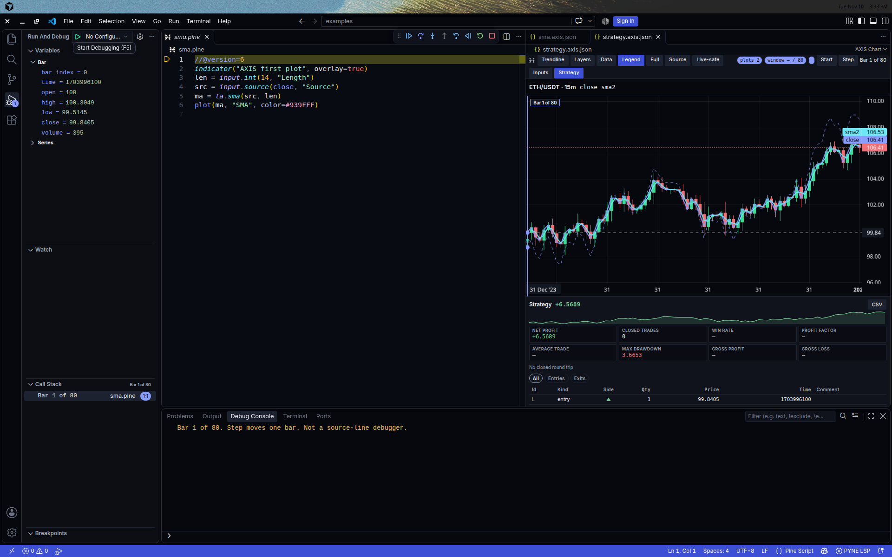

# AXIS IDE

A chart for Pine Script™, in the editor.

You write Pine Script™. AXIS opens a chart beside the file. You run it. The plot lands on the candles. A strategy can show its trades there too.

AXIS IDE is the chart and the run (`hoox-sh.axis-ide`). PYNE (`hoox-sh.pyne`) is the language extension: color, hover, warnings, and completion. This repo also contributes the **HOOX AXIS** and **HOOX AXIS Light** color themes, with token colors for Pine Script / PYNE scopes (`source.pinescript`) and chart up/down colors that match the candles.



Independent, unofficial extension. Not affiliated with, endorsed by, or sponsored by TradingView®, Inc.
Pine Script™ and TradingView® are trademarks of TradingView®, Inc.

## HOOX AXIS theme



**HOOX AXIS** is the dark theme (near-black surfaces, periwinkle accent, mint strings, gold numbers). **HOOX AXIS Light** is the light pair. Both color Pine Script / PYNE scopes, including `variable.language.series`, plot and builtin calls, and the `series` / `simple` semantic tokens. Chart greens and reds use the same up/down pair as the candles.

Pick either theme with **Preferences: Color Theme**. The sample folder `examples/` sets HOOX AXIS when you open that folder.

## Chart beside the script



Open a `.pine` or `.pyne` file and choose **AXIS: Open Chart**. The chart sits next to the script. A sibling `*.axis.json` file remembers the symbol, the timeframe, and any trendlines.

## Run and stop



**AXIS: Run Script** and **AXIS: Stop Run** use the same key, Ctrl+Enter (Cmd+Enter on a Mac). Stop is the one that shows while a run is going.

The local runner does not upload the script (`uploaded=0`). It tries Pyodide first. If that runtime cannot start (including a boot that does not finish), AXIS falls back to a local subset and says so in **AXIS: Show Run Output**: `engine=local-subset uploaded=0`. That subset plots `close` / `open` / `high` / `low` / `volume`, `ta.sma`, simple assignments, and `input.*`, and it can place one `strategy.entry`. A remote server stays off until you allow it.

## Plots and inputs



Run a study and the line shows up on the candles. `examples/sma.pine` plots an SMA and opens **Inputs** with Length and Source. Apply runs again with those values. The chart can also paint a histogram, an area, a fill, bars, candles, a horizontal line, and shapes when a run returns them.

## Strategy results



A strategy gets a short stats line, an equity sparkline, and a trade table. Click a trade to jump to that bar. `examples/strategy.pine` enters long on the first bar. The next indicator run clears that report so it does not linger on another chart.

## Drawings


**Trendline** draws a line on the candles and saves it in the sibling `*.axis.json`. Lines, labels, boxes, tables, and fills from the script are drawn when a run returns them.

## Pick a symbol



**AXIS: Pick Data** asks for a symbol, then a timeframe (`1m`, `5m`, `15m`, `1h`, `4h`, or `1d`). Bars can come from a CSV in the workspace, from sample candles, or from a local data feed on your machine. The feed is a separate program. It is not inside this extension. Sample candles are off unless `axis.chart.useMockBars` is true. The `examples/` folder turns them on so the chart has bars without a feed.

## Step a bar



**AXIS: Start Bar Debug** opens the debug view on the script and parks on a bar. **AXIS: Step Bar** moves one bar. Variables show the candle and the series, with Pine `na` where a value is missing. This is not a line-by-line script debugger. A breakpoint in the editor is left unverified; use **AXIS: Toggle Bar Breakpoint** to stop on a bar.

Hover, diagnostics, and completion live in PYNE, not in AXIS.

## Install

Search for **AXIS IDE** in the editor’s extension view. PYNE is required and should install with it.

From this repo, with [Bun](https://bun.sh):

```bash
bun run package
codium --install-extension axis-ide-<version>.vsix
```

You need an editor compatible with VS Code 1.95 or newer.

## If you work on this repo

```bash
bun install
bun run check
bun run test:unit
```

Sample scripts live in `examples/`. The walkthrough fixture is `fixtures/orb.pine`.

License: AGPL-3.0-only. See [LICENSE](./LICENSE) and [NOTICE](./NOTICE).

Bugs and questions: <https://github.com/hoox-sh/axis-ide-vsce/issues>
