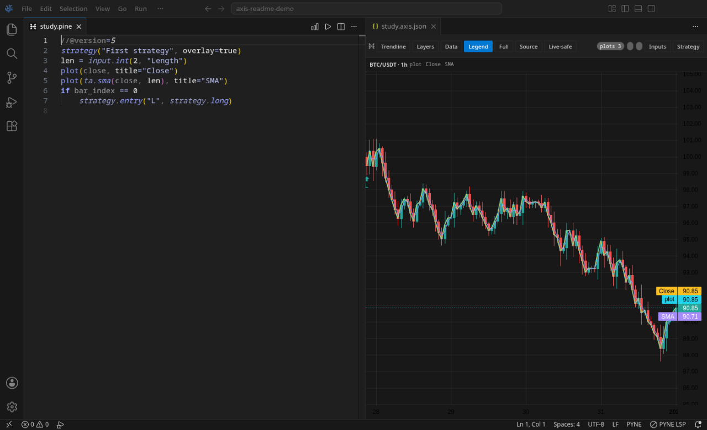
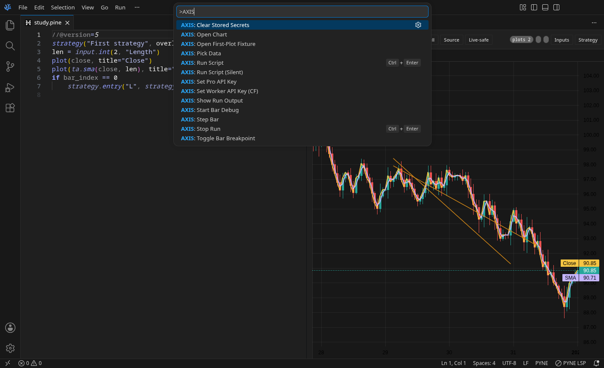
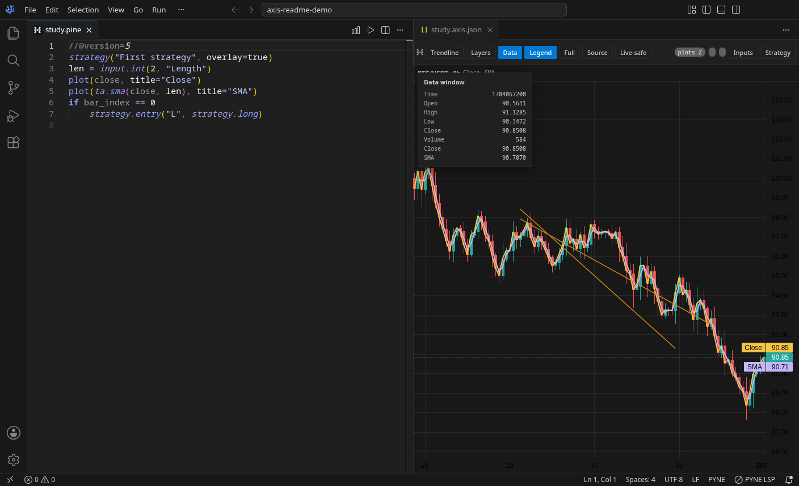
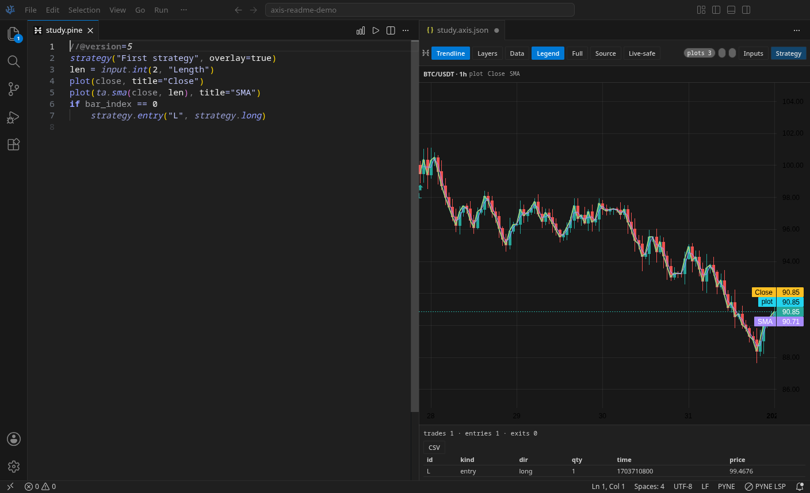
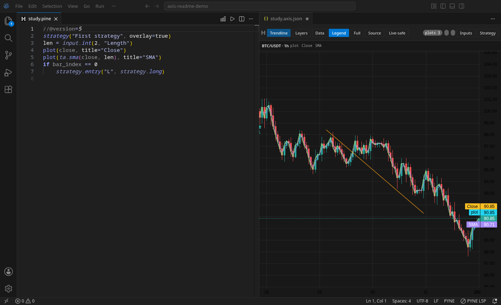
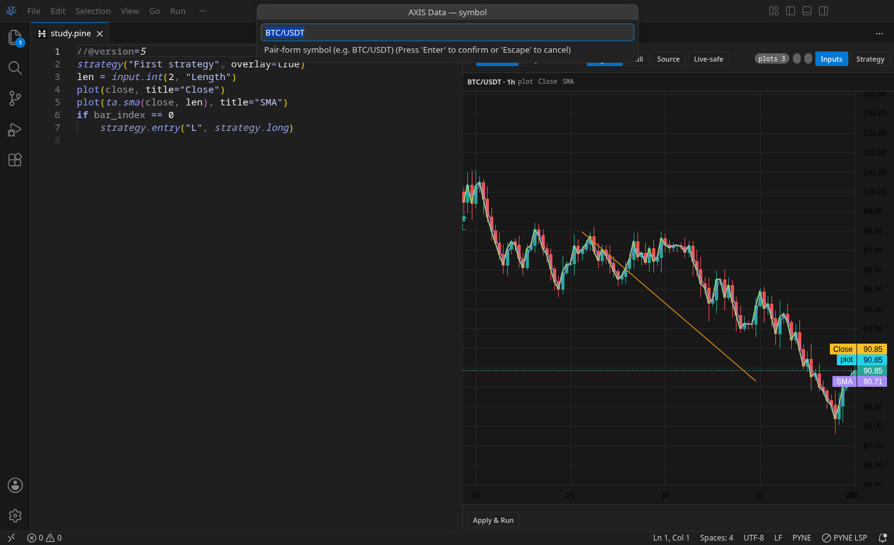
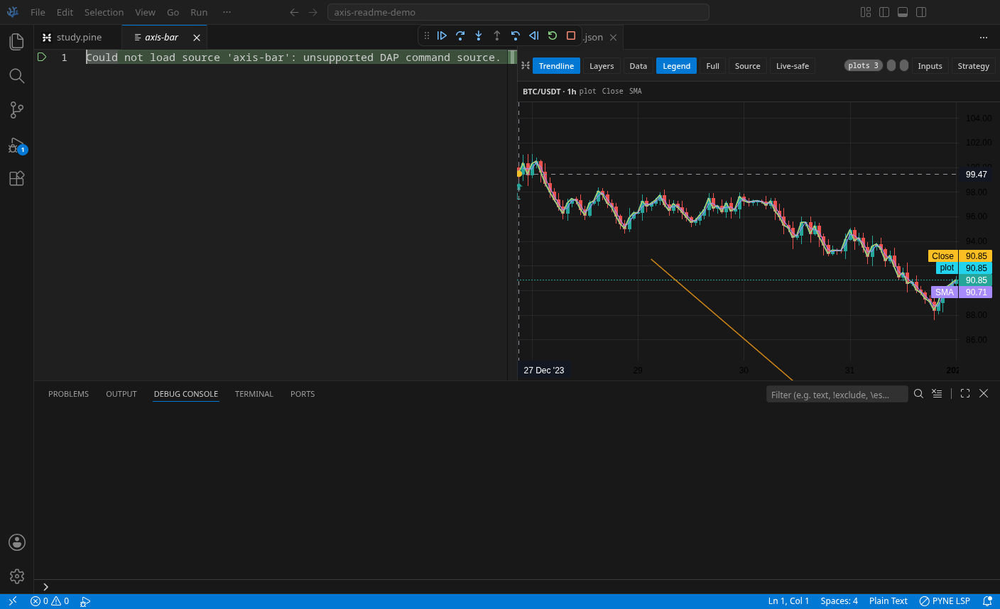

# AXIS IDE

A chart for Pine Script™, in the editor.

You write Pine Script™. AXIS opens a chart beside the file. You run it. The plot lands on the candles. A strategy can show its trades there too.

AXIS IDE is the chart and the run (`hoox-sh.axis-ide`). PYNE (`hoox-sh.pyne`) is the language extension: color, hover, warnings, and completion.


Independent, unofficial extension. Not affiliated with, endorsed by, or sponsored by TradingView®, Inc.
Pine Script™ and TradingView® are trademarks of TradingView®, Inc.

## Chart beside the script



Open a `.pine` or `.pyne` file and choose **AXIS: Open Chart**. The chart sits next to the script. A sibling `*.axis.json` file remembers the symbol and the timeframe.

## Run and stop



**AXIS: Run Script** and **AXIS: Stop Run** use the same key, Ctrl+Enter (Cmd+Enter on a Mac). Stop is the one that shows while a run is going.

An offline runner is on by default. It is meant to keep your script on your machine. In this build it did not finish starting. The pictures here are from a run sent to a server on this computer instead. Turn the offline runner off in settings if you want that path. A remote server stays off until you allow it.

## Plots



Run a Pine Script™ study and the line shows up on the candles. This one plots close and a short average. The chart can also paint a histogram, an area, a fill, bars, candles, a horizontal line, and shapes when the run returns them.

## Strategy results



A strategy gets a short stats line, a trade table, and a CSV button. Trade markers and an equity line are drawn when the run includes them. This run had one entry. Click a trade to jump to that bar.

An Inputs button sits on the same toolbar. On this run it opened with no fields, even though the script declares a length. Do not expect that form to be finished.

## Drawings



**Trendline** draws a line on the candles and can save it with the chart. Lines, labels, boxes, tables, and fills from the script are drawn when a run returns them.

## Pick a symbol



**AXIS: Pick Data** asks for a symbol, then a timeframe (`1m`, `5m`, `15m`, `1h`, `4h`, or `1d`). Bars can come from a CSV in the workspace, from sample candles, or from a local data feed on your machine. The feed is a separate program. It is not inside this extension.

## Step a bar



**AXIS: Start Bar Debug** opens the debug toolbar and can park on a bar. **AXIS: Step Bar** moves one bar. In this picture the session could not open a source file. It is not a line-by-line script debugger.

Hover, diagnostics, and completion live in PYNE, not in AXIS.

## Install

Search for **AXIS IDE** in the editor’s extension view. PYNE is required and should install with it.

From this repo, with [Bun](https://bun.sh):

```bash
bun run package
codium --install-extension axis-ide-<version>.vsix
```

You need an editor compatible with VS Code 1.95 or newer.

## If you work on this repo

```bash
bun install
bun run check
bun run test:unit
```

License: AGPL-3.0-only. See [LICENSE](./LICENSE) and [NOTICE](./NOTICE).

Bugs and questions: <https://github.com/hoox-sh/axis-ide-vsce/issues>
