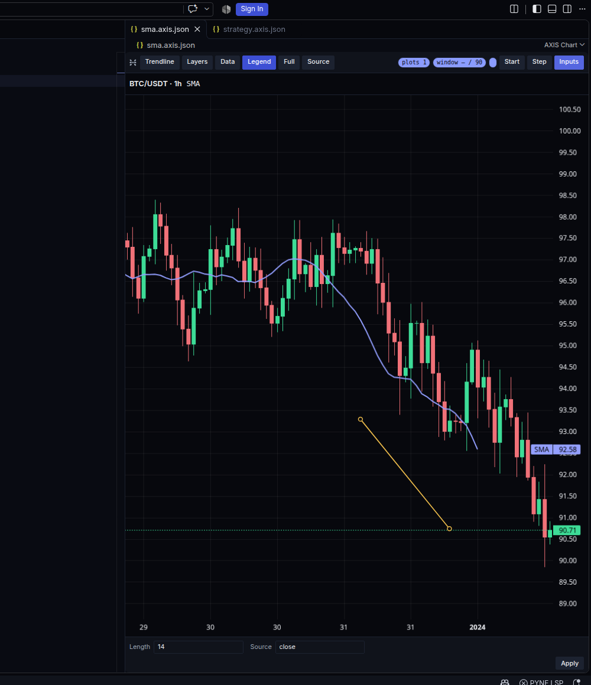
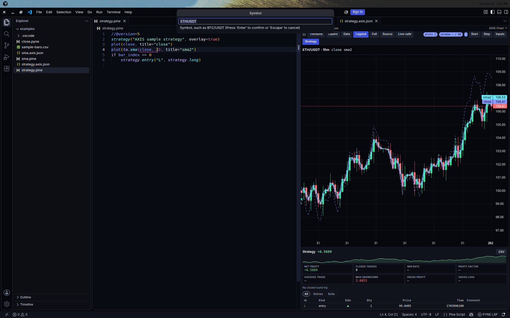
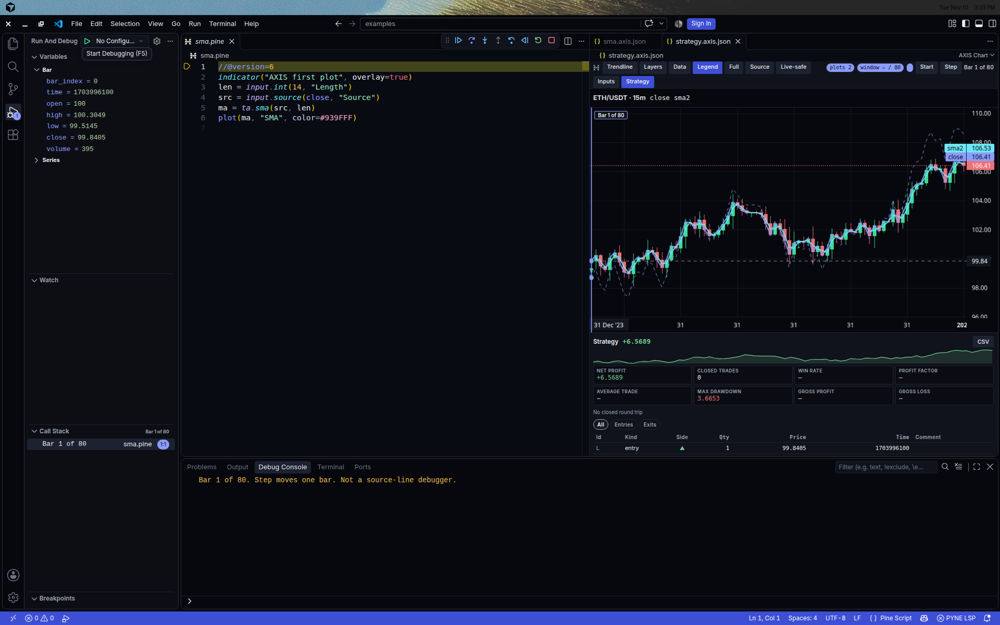
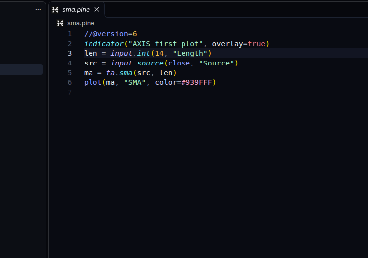

# AXIS IDE

A chart for Pine Script™, in the editor.

You write Pine Script™. You open a chart beside the file. You hit Ctrl+Enter (Cmd+Enter on a Mac). The plot lands on the candles right next to your script. That's the whole idea.


AXIS IDE is the chart and the run (`hoox-sh.axis-ide`). PYNE (`hoox-sh.pyne`) is the language extension: color, hover, warnings, and completion. You need PYNE to write Pine; AXIS is what runs it and paints the picture.

AXIS IDE also ships two color themes, **HOOX AXIS** and **HOOX AXIS Light**, with Pine Script / PYNE token colors and chart up/down colors that match the candles.

Independent, unofficial extension. Not affiliated with, endorsed by, or sponsored by TradingView®, Inc.
Pine Script™ and TradingView® are trademarks of TradingView®, Inc.

## Chart beside the script

Open a `.pine` or `.pyne` file and choose **AXIS: Open Chart**. The chart sits next to the script. A sibling `*.axis.json` file remembers the symbol, the timeframe, and any trendlines you draw.


## Run & Stop

**AXIS: Run Script** and **AXIS: Stop Run** share one key: Ctrl+Enter (Cmd+Enter on a Mac). Stop shows up while a run is going.

**AXIS: Choose How to Run** picks the engine. **Hosted** is the default: AXIS sends the script to `pynescript.online`. No API key. **This computer** installs the PYNE engine here and does not send the script. **In the editor** runs a Pine subset in Pyodide and logs `uploaded=0`. Numba, sessions, and cron are not available there. If that subset cannot start, a smaller local subset still plots (`engine=local-subset uploaded=0`). It handles `close` / `open` / `high` / `low` / `volume`, `ta.sma`, simple assignments, `input.*`, and one `strategy.entry`.


## Plots & Inputs

Run a study and the line shows up on the candles. `examples/sma.pine` plots an SMA and opens **Inputs** with Length and Source. Apply runs again with those values. The chart can also paint a histogram, an area, a fill, bars, candles, a horizontal line, and shapes when a run returns them.


## Strategy results

A strategy gets a short stats line, an equity sparkline, and a trade table. Click a trade to jump to that bar. `examples/strategy.pine` enters long on the first bar. The next indicator run clears the report so it doesn't linger.


## Drawings (trendline)

**Trendline** draws a line on the candles and saves it in the sibling `*.axis.json`. Lines, labels, boxes, tables, and fills from the script are drawn when a run returns them.



## Pick a symbol

**AXIS: Pick Data** asks for a symbol, then a timeframe (`1m`, `5m`, `15m`, `1h`, `4h`, or `1d`). Bars can come from a CSV in the workspace, from sample candles, or from a local data feed on your machine. Sample candles are on by default (`axis.chart.useMockBars`) so a fresh install paints and runs without a sidecar or `ccxt`.



## Step a bar / debug

**AXIS: Start Bar Debug** opens the debug view on the script and parks on a bar. **AXIS: Step Bar** moves one bar. Variables show the candle and the series, with Pine `na` where a value is missing. This isn't a line-by-line script debugger — use **AXIS: Toggle Bar Breakpoint** to stop on a bar.

Hover, diagnostics, and completion live in PYNE, not in AXIS.



## HOOX AXIS themes

**HOOX AXIS** is the dark theme (near-black surfaces, periwinkle accent, mint strings, gold numbers). **HOOX AXIS Light** is the light pair. Both color Pine Script / PYNE scopes, including plot and builtin calls, and chart greens and reds use the same up/down pair as the candles.

Pick either with **Preferences: Color Theme**. The `examples/` folder sets HOOX AXIS when you open that folder.



## Live venue data (Binance via ccxt, opt-in)

Sample candles are the default so Marketplace installs work without extra packages. For live OHLCV, set `axis.chart.useMockBars` to `false` and `axis.datafeed.source` to `venue` when `ccxt` is available in the extension host (dev tree: `bun add ccxt`). The Marketplace VSIX does not ship `ccxt`; without it AXIS falls back to Sample candles. Prefer the local axis-datafeed sidecar with `axis.datafeed.source` = `sidecar` at `http://127.0.0.1:5003`. Remote endpoints stay off by default.

## AXIS side panel

The **AXIS** icon on the activity bar opens the chart desk. It shows the symbol, the timeframe, where the bars come from (**Sample**, **CSV**, **Local feed**, or **Venue**), and the engine. Run, Stop, Open Chart, Pick Data, bar debug, and the engine menu are buttons on that panel. The same Run and Open Chart actions sit in the panel's title bar.

## Status bar

A HOOX mark sits in the status bar. Next to it is the open symbol and timeframe (`BTC/USDT · 1h`). While a script runs, the label spins. Click the button to open the AXIS side panel. The full command list is still **AXIS: Show AXIS Menu**. Turn the button off with `axis.statusbar.enabled`.

## Install

Search for **AXIS IDE** in the extension view. PYNE is required and installs with it.

From this repo, with [Bun](https://bun.sh):

```bash
bun run package
codium --install-extension axis-ide-0.4.0.vsix
```

You need an editor compatible with VS Code 1.95 or newer.

## If you work on this repo

```bash
bun install
bun run check
bun run test:unit
```

Sample scripts live in `examples/`. The walkthrough fixture is `fixtures/orb.pine`.

## Full local engine (optional)

The hosted engine is already the full PYNE runtime. Use the local engine when the script should stay on this machine:

1. Run **AXIS: Install Local Engine** (also offered in the first-run walkthrough). It creates a venv under `globalStorage/pyne-engine`, installs the backend wheel shipped in the VSIX, and switches `axis.engine.mode` to `local`.
2. Run a script with Ctrl+Enter.

No Python 3.10–3.13? Setup downloads a pinned standalone CPython 3.12 (~50 MB, SHA-256 verified) into `globalStorage/pyne-runtime`. Turn off `axis.engine.local.allowDownload` for air-gapped machines and point `axis.engine.local.python` at an interpreter instead.

AXIS starts `pyne-backend` on an ephemeral loopback port and sends runs to it through `/run`. A `PYNE local` status item shows starting / ready / error. **AXIS: Start Local Engine** and **AXIS: Stop Local Engine** control it by hand.

License: AGPL-3.0-only. See [LICENSE](./LICENSE) and [NOTICE](./NOTICE).

Bugs and questions: <https://github.com/hoox-sh/axis-ide-vsce/issues>
