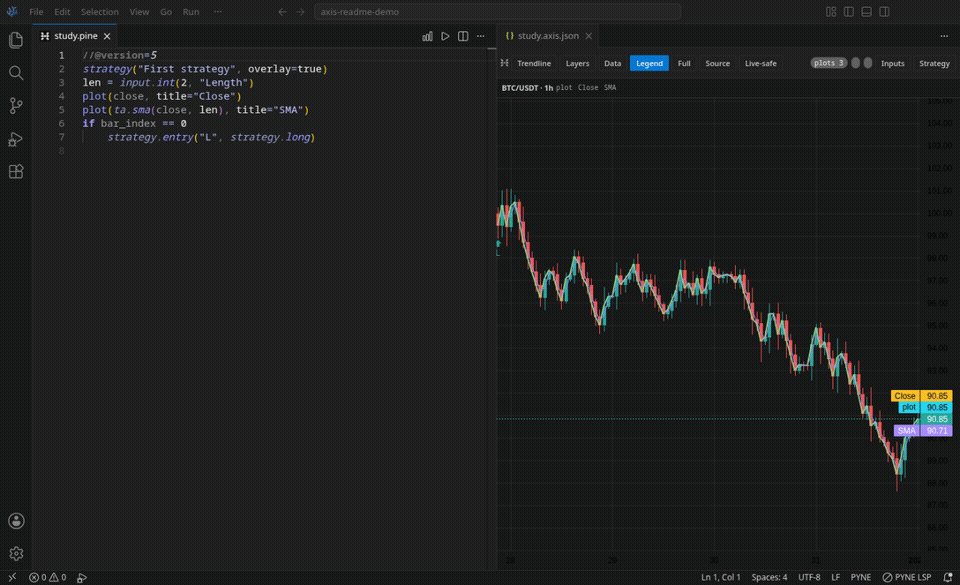
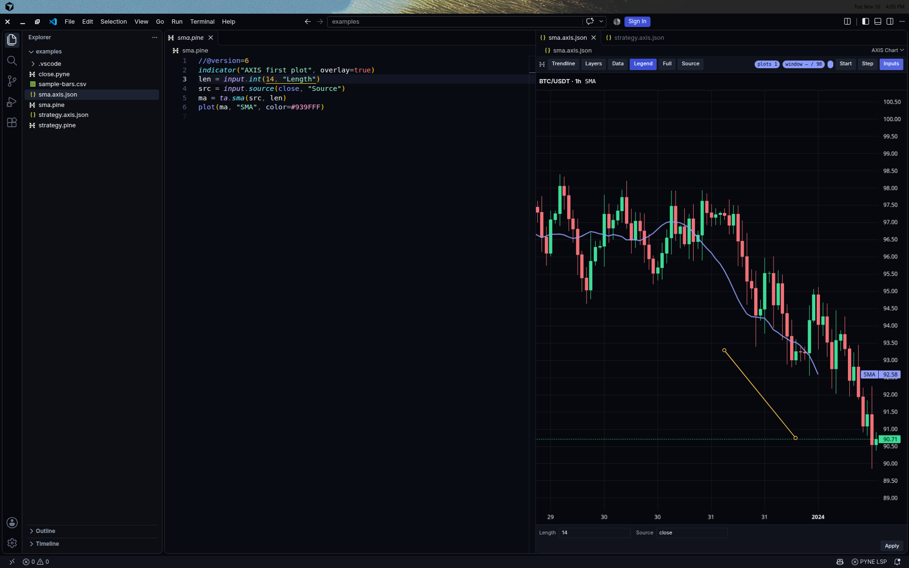
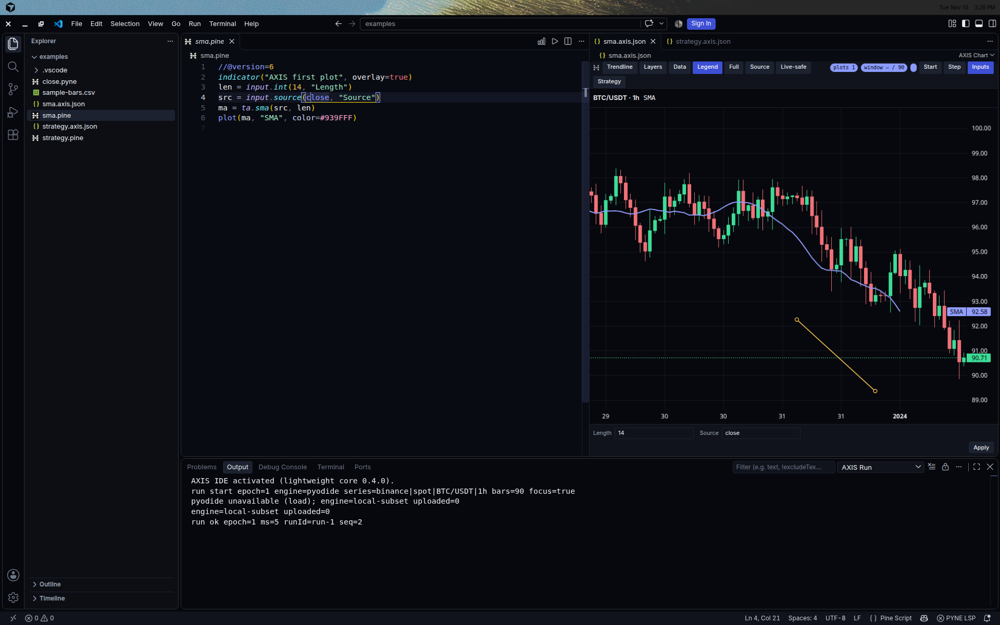
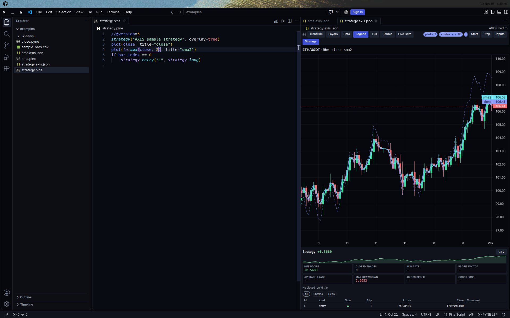

# AXIS IDE

A chart for Pine Script™, in the editor.

You write Pine Script™. You open a chart beside the file. You hit Ctrl+Enter (Cmd+Enter on a Mac). The plot lands on the candles right next to your script. That's the whole idea.



AXIS IDE is the chart and the run (`hoox-sh.axis-ide`). PYNE (`hoox-sh.pyne`) is the language extension: color, hover, warnings, and completion. You need PYNE to write Pine; AXIS is what runs it and paints the picture.

AXIS IDE also ships two color themes, **HOOX AXIS** and **HOOX AXIS Light**, with Pine Script / PYNE token colors and chart up/down colors that match the candles.

Independent, unofficial extension. Not affiliated with, endorsed by, or sponsored by TradingView®, Inc.
Pine Script™ and TradingView® are trademarks of TradingView®, Inc.

## Chart beside the script

Open a `.pine` or `.pyne` file and choose **AXIS: Open Chart**. The chart sits next to the script. A sibling `*.axis.json` file remembers the symbol, the timeframe, and any trendlines you draw.



## Run & Stop

**AXIS: Run Script** and **AXIS: Stop Run** share one key: Ctrl+Enter (Cmd+Enter on a Mac). Stop shows up while a run is going.

The script never leaves your machine (`uploaded=0`). AXIS tries Pyodide first. If Pyodide can't start, a local subset still plots and tells you in **AXIS: Show Run Output** (`engine=local-subset uploaded=0`). That subset handles `close` / `open` / `high` / `low` / `volume`, `ta.sma`, simple assignments, `input.*`, and one `strategy.entry`. A remote server stays off until you allow it.



## Plots & Inputs

Run a study and the line shows up on the candles. `examples/sma.pine` plots an SMA and opens **Inputs** with Length and Source. Apply runs again with those values. The chart can also paint a histogram, an area, a fill, bars, candles, a horizontal line, and shapes when a run returns them.


## Strategy results

A strategy gets a short stats line, an equity sparkline, and a trade table. Click a trade to jump to that bar. `examples/strategy.pine` enters long on the first bar. The next indicator run clears the report so it doesn't linger.



## Drawings (trendline)

**Trendline** draws a line on the candles and saves it in the sibling `*.axis.json`. Lines, labels, boxes, tables, and fills from the script are drawn when a run returns them.


## Pick a symbol

**AXIS: Pick Data** asks for a symbol, then a timeframe (`1m`, `5m`, `15m`, `1h`, `4h`, or `1d`). Bars can come from a CSV in the workspace, from sample candles, or from a local data feed on your machine. Sample candles are off unless `axis.chart.useMockBars` is true — the `examples/` folder turns them on so the chart has bars without a feed.


## Step a bar / debug

**AXIS: Start Bar Debug** opens the debug view on the script and parks on a bar. **AXIS: Step Bar** moves one bar. Variables show the candle and the series, with Pine `na` where a value is missing. This isn't a line-by-line script debugger — use **AXIS: Toggle Bar Breakpoint** to stop on a bar.

Hover, diagnostics, and completion live in PYNE, not in AXIS.


## HOOX AXIS themes

**HOOX AXIS** is the dark theme (near-black surfaces, periwinkle accent, mint strings, gold numbers). **HOOX AXIS Light** is the light pair. Both color Pine Script / PYNE scopes, including plot and builtin calls, and chart greens and reds use the same up/down pair as the candles.

Pick either with **Preferences: Color Theme**. The `examples/` folder sets HOOX AXIS when you open that folder.


## Live venue data (Binance via ccxt, on by default)

Bars come from live venue data by default. AXIS fetches OHLCV straight from Binance via ccxt — no sidecar needed, nothing to run yourself. Set `axis.datafeed.source` to `sidecar` if you'd rather use the local axis-datafeed sidecar at `http://127.0.0.1:5003`. Remote endpoints stay off by default.

## Statusbar HOOX menu

A HOOX logo sits in the statusbar. Click it for a popup of AXIS commands: Run Script, Stop Run, Open Chart, Pick Data, Show Run Output, Start Bar Debug, Step Bar, and more. Turn it off with `axis.statusbar.enabled`.

## Install

Search for **AXIS IDE** in the extension view. PYNE is required and installs with it.

From this repo, with [Bun](https://bun.sh):

```bash
bun run package
codium --install-extension axis-ide-0.4.0.vsix
```

You need an editor compatible with VS Code 1.95 or newer.

## If you work on this repo

```bash
bun install
bun run check
bun run test:unit
```

Sample scripts live in `examples/`. The walkthrough fixture is `fixtures/orb.pine`.

## Full local engine (optional)

For the full PYNE runtime (Numba `compile`, sessions, `optimize`, batch), point AXIS at the packaged backend:

1. Run **AXIS: Install Local Engine** (also offered in the first-run walkthrough). It creates a venv under `globalStorage/pyne-engine`, installs the backend wheel shipped in the VSIX, and switches `axis.engine.mode` to `local`.
2. Run a script with Ctrl+Enter.

No Python 3.10–3.13? Setup downloads a pinned standalone CPython 3.12 (~50 MB, SHA-256 verified) into `globalStorage/pyne-runtime`. Turn off `axis.engine.local.allowDownload` for air-gapped machines and point `axis.engine.local.python` at an interpreter instead.

AXIS starts `pyne-backend` on an ephemeral loopback port and sends runs to it through `/run`. A `PYNE local` status item shows starting / ready / error. **AXIS: Start Local Engine** and **AXIS: Stop Local Engine** control it by hand.

License: AGPL-3.0-only. See [LICENSE](./LICENSE) and [NOTICE](./NOTICE).

Bugs and questions: <https://github.com/hoox-sh/axis-ide-vsce/issues>
