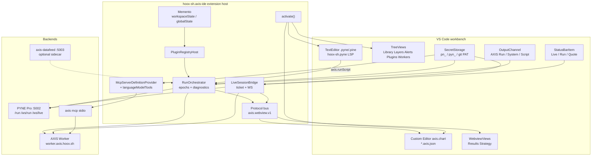
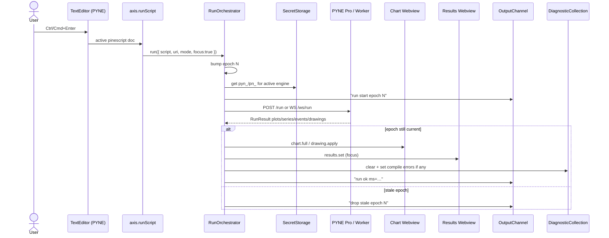

# AXIS IDE — VS Code Extension Design

| Field | Value |
| --- | --- |
| **Title** | AXIS VS Code Extension ("AXIS IDE") — Production Design |
| **Author** | AXIS design loop |
| **Date** | 2026-11-02 |
| **Status** | Draft — open questions **user-locked** 2026-11-02 |
| **License target** | AGPL-3.0-only (match AXIS PWA; see § Key Decisions / license) |
| **Extension id** | `hoox-sh.axis-ide` |
| **Extension pack id** | `hoox-sh.axis` |
| **Hard dependency** | `hoox-sh.pyne` (id-only in `extensionDependencies`; **recommended ≥0.5.4** in README + runtime warn) |
| **Monorepo path** | `packages/vscode-axis-ide/` (+ thin `packages/vscode-axis-pack/`) — sibling packages via `bun --cwd`, **not** npm/bun workspaces |
| **IDE semver** | Independent of root `VERSION` / `scripts/sync-versions.mjs` (those stamp app/worker/tauri only) |

---

## Overview

AXIS today is a SolidJS + Vite charting PWA (`/mnt/data/home/jango/Git/axis`) that runs Pine Script™ via PYNE engines (Pro API, Cloudflare Worker, Pyodide), paints TradingView Lightweight Charts, and exposes library/layers/alerts/plugins/MCP. Editing in the PWA uses CodeMirror 6. Language support already ships separately as the **PYNE Language Support** extension `hoox-sh.pyne` v0.5.4 (`/mnt/data/home/jango/Git/pynescript/vscode-extension`) — LSP, grammar, themes, format, convert, and a synthetic one-bar `pynescript.runOnPro`. There is no marketplace extension that embeds a full AXIS-class chart IDE beside a Pine buffer.

This design specifies **AXIS IDE**: a production VS Code extension that clones the AXIS PWA feature surface **inside VS Code**, native-first. Pine source editing stays on the VS Code `TextEditor` + `hoox-sh.pyne` LSP (no CodeMirror/Monaco embed, no LSP fork). Chart chrome, Lightweight Charts, drawings, and equity visuals live in webviews / custom editors. Run orchestration, secrets, live WS, diagnostics publishers, MCP registration, and plugin registry live in the extension host. Packaging is a hard-dependent IDE VSIX plus an optional one-click extension pack with PYNE.

---

## Background & Motivation

### Current state

| Surface | Where it lives today | Gap in VS Code |
| --- | --- | --- |
| Pine edit / lint / format | PWA CodeMirror **or** `hoox-sh.pyne` | Language solved by PYNE; no chart |
| Run + apply + results | `src/indicators/runner.ts`, Results modal | PYNE `runOnPro` is synthetic one-bar only |
| Live stream | `src/streams/stream-live.ts` + `StreamLiveWire` | None |
| Chart / drawings | `src/chart/*` + LWC | None (MiniBT Charts is closest prior art; iframe of external UI) |
| Library / layers / alerts / plugins | Solid panels + Tree-like UI | None |
| Secrets | `src/storage/vault.ts` | PYNE stores `pynescript.pro.apiKey` in **plain settings** |
| MCP | `src/mcp/*`, Worker `/mcp`, `axis mcp` CLI | Not registered from an AXIS IDE extension |

Marketplace prior art (research-task-format § Prior Art) stops at language/lint. AXIS’s differentiator is **run + stream + chart + results inside the editor**, packaged **beside** (not instead of) PYNE language support.

### Pain points this solves

1. Developers who already live in VS Code / Cursor / VSCodium leave the IDE to use the AXIS PWA for chart feedback.
2. PYNE’s Run-on-Pro cannot exercise full market history, live WS, or multi-pane apply.
3. Secrets for Worker `pn_…` / Pro `pyn_…` keys should not follow PYNE’s plaintext settings pattern.
4. Agents already use AXIS/PYNE MCP; VS Code’s native MCP + `languageModelTools` need a first-class AXIS registration path without inventing Chat Participants (deprecated for Copilot harness work, 2026).

### Evidence cited

- Research drafts (authoring): `/tmp/grok-jango/research-*-118d12d1.md` — **before generating task JSON**, copy into repo as `.opencode/plans/research/*.md` and point `context_files` there (not `/tmp`).
- AXIS tree: `src/chart`, `src/editor`, `src/results`, `src/plugins`, `src/mcp`, `src/store`, `src/engine/live-ticket.ts`, `src/engines`, `packages/cli`, `packages/datafeed`.
- Plan style: `.opencode/plans/final/plan.mdx`, task JSON under `.opencode/tmp/tasks/live-session-status/`.
- Results focus: `src/store/index.ts` `setLastRun`, `tests/run-results-focus.test.ts`.

---

## Goals & Non-Goals

### Goals

1. Ship `hoox-sh.axis-ide` that activates with PYNE and provides chart custom editor, results/strategy views, run/live commands, library/layers/alerts trees, status HUD, Output channels, SecretStorage-backed keys, plugin registry, and MCP / LM tool registration.
2. Prefer **native VS Code APIs** wherever they are sufficient (TextEditor, Problems, OutputChannel, TreeView, StatusBarItem, SecretStorage, Terminal, `contributes.configuration`, Command Palette).
3. Reuse AXIS engine apply semantics (`runAndApply`, stream `full`/`delta` wire) behind a headless host adapter; paint only in webviews.
4. Depend on `hoox-sh.pyne` via `extensionDependencies` — never fork or rebundle the LSP.
5. High test coverage with CI gates that **mirror AXIS ratchet practice**: scoped pure-host **BASELINE** (fail on regression) ratcheting toward TARGET ≥90% lines; package-overall TARGET ≥80% with vendor/LWC excludes; protocol round-trips **100%** (always enforced). Measurement via **`bun test --coverage`** inside the package (see KD-13).
6. Produce a PR plan and task breakdown granular enough to generate `.opencode/plans/` MDX and `.opencode/tmp/tasks/axis-vscode-ext/subtask_NN.json`.

### Non-Goals

- **No TradingView Advanced Charts** (or any TV Charting Library license path). Chart tech is **Lightweight Charts** Apache-2.0 only, same as the PWA.
- **No forking / vendoring PYNE LSP** into AXIS IDE. Language features remain `hoox-sh.pyne`.
- **No rebranding as TradingView** / claiming affiliation. Pine Script™ and TradingView® remain trademarked third-party names (see `AGENTS.md`).
- **No embedded CodeMirror or Monaco** for Pine buffers.
- **No new Chat Participants** for Copilot (deprecated path). Use MCP + `languageModelTools`.
- **No full PWA shell chrome** (Topbar/CommandPalette Solid clones) when native Command Palette / StatusBar suffice.
- **Not** a replacement for the hosted AXIS PWA / Tauri desktop for users who want the browser product; IDE is a sibling surface.
- **Not** bundling the entire Solid PWA `dist/` as an opaque iframe long-term (allowed only as a short-lived bootstrap if needed; target is extracted chart runtime + host orchestration).

---

## Key Decisions

| # | Decision | Rationale |
| --- | --- | --- |
| KD-1 | Package under AXIS monorepo at **`packages/vscode-axis-ide/`** (pack at `packages/vscode-axis-pack/`) as a **sibling package** (like `packages/cli`), invoked via `bun --cwd` root scripts — **not** npm/bun `workspaces` | Root `package.json` has no `workspaces` field; `bunfig.toml` `pathIgnorePatterns` already excludes `packages/**` from root `bun test`. Prefer monorepo over a separate git repo for AGPL headers + eventual `src/` extraction (see A7). IDE **semver is independent** of root `VERSION` / `scripts/sync-versions.mjs` (those stamp app/worker/tauri only). |
| KD-2 | Extension id **`hoox-sh.axis-ide`**, pack **`hoox-sh.axis`** | IDE is the functional product; pack is soft one-click UX (`extensionPack`). Hard edge is `extensionDependencies: ["hoox-sh.pyne"]` on the IDE. |
| KD-3 | License **AGPL-3.0-only** for AXIS IDE (and pack); file headers **must not** say “or later” | Matches AXIS `NOTICE` / root SPDX. Many PWA `src/**` headers still say “or later” while SPDX is only — **do not copy that inconsistency**. IDE boilerplate: SPDX `AGPL-3.0-only` + header text “version 3 only”. PYNE ext remains **AGPL-3.0-or-later**; pack README call-out; do not relicense PYNE. VSIX NOTICE must list Lightweight Charts Apache-2.0. |
| KD-4 | **Native editor only** for Pine; chart = **`CustomEditorProvider`** on `*.axis.json` from **PR-04 onward** (not Readonly→Editable mid-flight) | Dirty/save/revert/backup for layout + drawings land with the same provider kind. Use `CustomDocumentContentChangeEvent` early; promote to full `CustomDocumentEditEvent` undo when drawing ops need it. Never bind custom editor as `default` on `*.pyne`. |
| KD-5 | **Do not fork LSP**; `extensionDependencies: ["hoox-sh.pyne"]` is **id-only** (VS Code has no semver here) | Document **recommended ≥0.5.4** in README; electron test reads installed PYNE `packageJSON.version` and **warns** if older. |
| KD-6 | Host owns run/live/secrets; webview owns LWC paint + drawing hit-testing | Same split as Jupyter plot viewers / AXIS Tauri webview host. Minimizes DOM in extension host. Default webview `connect-src 'none'` — host proxies network. |
| KD-7 | Typed message protocol (`axis.webview.v1`) — thin AXIS protocol first; adopt `vscode-messenger` only if multi-webview routing pain appears | Keep zero extra runtime deps initially; schema-version every message. |
| KD-8 | Secrets via **`ExtensionContext.secrets`** (`SecretStorage`); never persist `pn_` / `pyn_` in `settings.json` | Improves on PYNE `pynescript.pro.apiKey` plaintext; mirrors PWA vault slots. Worker keys validated `/^pn_[a-f0-9]{48}$/` (`WORKER_API_KEY_RE` in `src/engine/live-ticket.ts`). |
| KD-9 | MCP via **`mcpServerDefinitionProviders`** + **`languageModelTools`**; resolve CLI: `axis.mcp.command` (if set) → `which axis` → **only if** `axis.mcp.allowNpx` (default **false**) then `npx -y @hoox-sh/axis-cli` → else **soft-fail** (empty definitions + warning + `axis.mcp.showConfig`) | Never assume monorepo `bun packages/cli/bin/axis.js` for Marketplace users. **npx is opt-in**, not the default soft path — so `if (!resolved)` is reachable. Key only via env `AXIS_API_KEY`. |
| KD-10 | Phased chart reuse: **P0–P1** mock/minimal LWC webview; **P2+** import chart apply helpers; extract `@hoox-sh/axis-runtime` **only when** there is a **3rd consumer OR ≥5 duplicated modules** vs the PWA | Avoid premature package extraction; trigger locked (resolved Q2). |
| KD-11 | Engines: `vscode ^1.95.0` (Custom Editor + MCP provider + LM tools stable set); desktop `extensionKind: ["workspace"]` first; **web extension deferred indefinitely** (resolved Q3) | PYNE requires `^1.91.0`; MCP provider API finalized ~May 2025 — require a newer floor for AXIS IDE. |
| KD-12 | Dual-publish Marketplace + Open VSX | PYNE already on Open VSX; Cursor/Windsurf/VSCodium need Open VSX. |
| KD-13 | **Unit tests = `bun test`** inside `packages/vscode-axis-ide` (+ local `scripts/check-coverage.mjs`); integration = `@vscode/test-electron`; **no vitest** unless a later ADR justifies jsdom-only webview reducers | Matches `packages/cli` and root Bun culture; root discovery already ignores `packages/**`. Electron tests compile separately (PYNE pattern). |
| KD-14 | **Contribute inventory grows with PRs** — Task 02 / PR-01 electron tests assert **only the P0 command/setting set**; later tasks append expected ids | Avoids “assert all Appendix commands on day one.” Appendices remain the **1.0** inventory. |
| KD-15 | Activation: **no `onStartupFinished`**; activate via contribute-derived events + `workspaceContains` for `*.axis.json` / pine globs + explicit commands/views/customEditor | Avoid always-on host cost. MCP provider registers on first IDE activation (open chart / AXIS view / AXIS command). Users who need MCP without opening AXIS run `axis.mcp.showConfig` once (activates). |

---

## Proposed Design

### 1. Packaging topology

```
axis/                                      # monorepo root (private, AGPL-3.0-only)
├── packages/
│   ├── cli/                               # @hoox-sh/axis-cli (existing)
│   ├── datafeed/                          # @hoox-sh/axis-datafeed (existing)
│   ├── vscode-axis-ide/                   # NEW — hoox-sh.axis-ide
│   │   ├── package.json
│   │   ├── esbuild.host.mjs
│   │   ├── vite.webview.config.ts
│   │   ├── src/
│   │   │   ├── extension.ts               # activate / deactivate
│   │   │   ├── host/                      # pure TS (high coverage)
│   │   │   ├── views/                     # TreeDataProviders, WebviewViewProviders
│   │   │   ├── editors/                   # Custom editor providers
│   │   │   ├── protocol/                  # axis.webview.v1 types + codecs
│   │   │   ├── secrets/                   # SecretStorage façade
│   │   │   ├── run/                       # run orchestration, epochs
│   │   │   ├── live/                      # WS clients, tickets
│   │   │   ├── mcp/                       # McpServerDefinitionProvider + LM tools
│   │   │   ├── plugins/                   # host-side registry adapter
│   │   │   └── test/                      # @vscode/test-electron suites
│   │   ├── webview/                       # browser bundles (Vite)
│   │   │   ├── chart/                     # LWC host, panes, drawings chrome
│   │   │   ├── results/                   # equity / strategy HTML
│   │   │   └── shared/                    # theme bridge, messenger client
│   │   ├── media/                         # icons, CSP-safe assets
│   │   └── coverage/                      # bun test --coverage (lcov)
│   └── vscode-axis-pack/                  # NEW — hoox-sh.axis (extensionPack only)
│       └── package.json                   # own package.json; own bun install if needed
└── src/                                   # PWA modules (import / extract later)
```

**Integration (not workspaces):** like `packages/cli` / `packages/datafeed` — separate `package.json`, root scripts use `bun --cwd packages/vscode-axis-ide …`. Root `bun test` does **not** discover IDE tests (`pathIgnorePatterns: packages/**`). Do **not** add the IDE version to `scripts/sync-versions.mjs` unless a later ADR opts in.

**VSIX build**

| Bundle | Tool | Output | Notes |
| --- | --- | --- | --- |
| Extension host | esbuild (mirror PYNE `esbuild.mjs`) | `dist/extension.js` | `external: ['vscode']`, CJS, Node 18+, sourcemaps |
| Chart webview | Vite | `dist/webview/chart/` | No Node built-ins; LWC standalone |
| Results webview | Vite | `dist/webview/results/` | Equity curve canvas/SVG |
| Package | `@vscode/vsce package --no-dependencies` | `axis-ide-<ver>.vsix` | Same flag as PYNE; host deps bundled |
| Pack | vsce | `axis-<ver>.vsix` | Manifest-only pack |

Root scripts (suggested):

```json
"vscode:ide:compile": "bun run --cwd packages/vscode-axis-ide compile",
"vscode:ide:test": "bun run --cwd packages/vscode-axis-ide test",
"vscode:ide:package": "bun run --cwd packages/vscode-axis-ide package"
```

### 2. Architecture (host ↔ webview ↔ engines)



### 3. UI mapping (native-first)

| AXIS PWA surface | VS Code mapping | Implementation notes |
| --- | --- | --- |
| CodeMirror Pine buffer | **Native TextEditor** + `hoox-sh.pyne` | Do not open custom editor as default for `*.pyne` |
| Chart workspace | **Custom Editor** `axis.chart` on `*.axis.json`; **`axis.openChart` creates/updates a sibling `*.axis.json` next to the active `.pyne`/`.pine`** (e.g. `rsi.pyne` → `rsi.axis.json`) | **`CustomEditorProvider` from PR-04** (KD-4). Content-change dirty for JSON edits; drawings persist into the same document. No Readonly→Editable switch. |
| Results focus | WebviewView + host `ResultsFocusStore` | Normative rules in §7.1 (mirror `setLastRun`) |
| Drawing toolbar / SVG overlay | Webview inside chart custom editor | Tool **palette** can also be a TreeView of tool ids that posts `drawing.setTool` |
| Results / strategy / equity | **WebviewView** in Panel container `axis` | Mirror `setLastRun` focus rules (`focus:true` vs silent live) |
| Script logs | **OutputChannel** `AXIS Script Logs` | Plus optional Results tab |
| System / run logs | OutputChannels `AXIS System`, `AXIS Run` | |
| Diagnostics from runs | `DiagnosticCollection` `axis-run` | LSP diagnostics stay in PYNE |
| Library | **TreeView** `axis.library` | FS + cloud storage plugins via host registry |
| Layers | **TreeView** `axis.layers` | Order: Scripts → Panes → Overlays → On-chain → Drawings (PWA rule) |
| Indicators list | TreeView `axis.indicators` | |
| Alerts | TreeView `axis.alerts` + `window.showNotification` / OS notify | Create/edit via QuickPick or small WebviewView form |
| Watchlist / quote | TreeView + **StatusBarItem** last price | `displayedLastPrice` semantics from `src/ui/extras/quote.ts` |
| Workers Manager | TreeView `axis.workers` + Terminal for wrangler/pip | Probe catalog from `src/workers/catalog.ts` |
| Plugins Manager | TreeView `axis.plugins` + Settings | Kinds: `source\|stream\|engine\|storage\|dataset\|component` |
| Studio settings | `contributes.configuration` `axis.*` | Complex Wire visualizer deferred to optional WebviewPanel |
| Command palette | Native commands `axis.*` | Mirror high-value PWA intents |
| MCP HUD | StatusBar + MCP Servers UI | |
| Themes | Reuse PYNE workbench themes; push chart theme tokens into webview | `onDidChangeActiveColorTheme` |

### 4. Activation & lifecycle

**Activation events (IDE)** — KD-15; **no** `onStartupFinished`:

```json
"activationEvents": [
  "onCustomEditor:axis.chart",
  "onView:axis.results",
  "onView:axis.library",
  "onCommand:axis.runScript",
  "onCommand:axis.openChart",
  "onCommand:axis.mcp.showConfig",
  "onCommand:axis.secrets.setWorkerKey",
  "workspaceContains:**/*.axis.json",
  "workspaceContains:**/*.pyne",
  "workspaceContains:**/*.pine"
]
```

(Modern VS Code also activates from `contributes` for views/commands/customEditors; the explicit list documents intent and covers older engines.)

`activate(context)` sequence:

1. Assert / soft-warn if `hoox-sh.pyne` missing (dependencies normally guarantee install).
2. Init `SecretStorage` façade + migrate any legacy plaintext if we ever wrote settings (none at v1).
3. Register OutputChannels, StatusBarItems, DiagnosticCollection.
4. Register TreeDataProviders + WebviewViewProviders.
5. Register Custom Editor provider (`supportsMultipleEditorsPerDocument: true`).
6. Register commands + keybindings (Run: `ctrl+enter` / `cmd+enter` when `editorLangId == pinescript`).
7. Register MCP provider + LM tools.
8. Restore `workspaceState` chart session stubs (symbol/interval/engine id — not bars).

`deactivate()`: abort runs, close WS, dispose webviews, flush memento.

### 5. Chart document model

**File format `*.axis.json` (v1):**

```json
{
  "schema": "axis.chart.v1",
  "symbol": "BTC/USDT",
  "exchange": "binance",
  "market": "spot",
  "interval": "1m",
  "historyBars": 1500,
  "chartType": "candles",
  "theme": "void",
  "panes": [{ "id": "price", "kind": "price" }],
  "scripts": [{ "id": "…", "uri": "./rsi.pyne", "inputs": {} }],
  "drawings": [],
  "engine": "server",
  "source": "binance"
}
```

- Bars and live series are **ephemeral** (host memory / webview state), not written into the JSON (mirrors PWA: `bars` ephemeral in `AppState`).
- **History sequencing (normative):**
  - **Through PR-06 / PR-07 (P1–P2):** bars are **mock or fixture only**. `RunRequest.bars` comes from the mock chart session. No venue/`fetchHistorical` required for exit criteria.
  - **PR-06b (new) / Task 11:** host `HistoryClient` — construct canonical `seriesKey` (`exchange|market|SYMBOL|interval`, see `src/engine/frames.ts` / market-identity helpers), call active `source.fetchHistorical` or `axis-datafeed` (`packages/datafeed`, default `:5003`), then post `chart.full` and feed `RunOrchestrator`.
  - **After PR-06b:** custom editor resolve → HistoryClient → `chart.init` / `chart.full`; Run uses the same bar window.
- Dirty document when user changes symbol/layout/drawings that persist (`CustomEditorProvider` save/revert).

**Chart file UX (locked Q1):** `axis.openChart` always creates/updates a **sibling** `*.axis.json` beside the Pine file. Untitled `axis:` virtual docs are **out of scope** for v1.


### 6. Message protocol `axis.webview.v1`

All webview ↔ host messages are JSON with:

```ts
interface Envelope<T = unknown> {
  v: 1;
  id?: string;          // correlate request/response
  type: string;         // e.g. "chart.full"
  payload: T;
  ts: number;           // Date.now()
}
```

**Chart webview ← host (notifications / responses)**

| `type` | Payload (summary) | Notes |
| --- | --- | --- |
| `chart.init` | `{ theme, cssVars, seriesKey, panes }` | After resolve |
| `chart.full` | `{ bars, plots?, drawings?, seq }` | Snapshot |
| `chart.delta` | `{ baseIndex, tail, plots?, seq }` | Live append; mirror engine wire |
| `chart.theme` | `{ kind, cssVars }` | Color theme change |
| `chart.drawing.apply` | script drawings batch | From apply path |
| `host.run.status` | `{ epoch, state, message? }` | HUD sync |
| `host.error` | `{ code, message }` | User-visible |

**Chart webview → host**

| `type` | Payload | Notes |
| --- | --- | --- |
| `webview.ready` | `{ view: "chart", capabilities }` | |
| `chart.viewport` | `{ from, to, logical? }` | Debounced |
| `drawing.setTool` | `{ tool }` | |
| `drawing.commit` | drawing object | Persist into doc |
| `chart.requestReload` | `{}` | |

**Results webview**

| `type` | Direction | Payload |
| --- | --- | --- |
| `results.set` | host→view | `{ lastRun, strategyReport, focusId }` |
| `results.focus` | view→host | `{ runId }` |
| `results.ready` | view→host | |

**Rules**

- Validate with zod/valibot (or hand codecs) on **both** sides; drop unknown `type` with log.
- Prefer compact typed arrays / column slices for deltas — never spam per-tick full plots over `postMessage` (research webview perf notes).
- Do not put secrets in any webview message.
- CSP: no inline script; nonce or `webview.cspSource` only.

### 7. Run sequence



Host implementation sketch (pure module, unit-tested):

```ts
// packages/vscode-axis-ide/src/host/run/orchestrator.ts
export type RunRequest = {
  script: string;
  uri?: string;
  mode: 'auto' | 'interpret' | 'compile';
  focus: boolean;
  bars: Bar[];
  seriesKey: string;
  engineId: string;
  signal?: AbortSignal;
};

export class RunOrchestrator {
  private epoch = 0;
  async run(req: RunRequest, deps: RunDeps): Promise<void> {
    const my = ++this.epoch;
    const token = await deps.secrets.resolveEngineKey(req.engineId);
    const result = await deps.engines.run(req, token);
    if (my !== this.epoch) return; // stale
    deps.bus.notifyChart({ type: 'chart.full', … });
    deps.results.publish(result, { focus: req.focus });
  }
}
```

Reuse semantics from `src/indicators/runner.ts`: epochs, `setLastRun` focus rules, `normalizeEngineResult`. Prefer adapting those modules behind a non-DOM `RunDeps` rather than importing Solid `store` into the host.

### 7.1 Results focus rules (normative)

Mirror `setLastRun` in `src/store/index.ts` and `tests/run-results-focus.test.ts` / axis-editor-results memory:

| Event | `focus` | Host behavior | Webview `results.set` |
| --- | --- | --- | --- |
| User Run (`axis.runScript`) | `true` | Write `runResults[id]`; set `newestRunId`; publish `lastRun` + `resultsFocusId` | Payload includes focused `lastRun` + `strategyReport` |
| Silent / live tick (`axis.runScriptSilent`, live delta apply) | `false` | Write `runResults[id]`; update `newestRunId`; **do not** change `lastRun` / `resultsFocusId` if already focused | Optional: push per-script cache only; Results panel stays on focus id |
| First run ever (`resultsFocusId == null`) | any | Treat as publish (same as focus) | Shows that run |
| `axis.focusResults` / tree select | n/a | Set `resultsFocusId`; `results.set` with that id’s cached run | Panel retargets |

MCP/LM tool `axis_get_results_focus` returns `{ resultsFocusId, newestRunId, lastRunSummary }` for the **focus** id — not necessarily `newestRunId` (PWA `results.get` parity).

### 8. Live tick sequence

```mermaid
sequenceDiagram
  participant User
  participant Host as LiveSessionBridge
  participant Sec as SecretStorage
  participant Wrk as AXIS Worker / PYNE
  participant Wire as StreamLiveWire-compat client
  participant Chart as Chart Webview
  participant SB as StatusBar

  User->>Host: axis.liveStart
  Host->>Sec: get cloud.apiKey (pn_ validated)
  alt Worker live proxy (shouldUseLiveProxy)
    Host->>Wrk: GET /api/ws/live?issue=ticket<br/>Authorization: Bearer pn_…
    Wrk-->>Host: { ticket } (32 hex, TTL 60s)
    Host->>Wrk: WS wss://…/api/ws/live?ticket=…<br/>(never ?key=; never long-lived pn_ on URL)
  else Pro direct (loopback engine or no worker key)
    Host->>Wrk: WS /ws/live with engine auth frame / Bearer pyn_…
  end
  Host->>Wire: subscribe series + scripts
  Wire-->>Host: status datafeed-loading→calculating→live
  Host->>SB: "AXIS Live"
  Wire-->>Host: full {seq, bars?, plots?}
  Host->>Chart: chart.full
  loop ticks
    Wire-->>Host: delta {seq, tail…}
    Host->>Chart: chart.delta
    Note over Host,Wire: seq gap → resume/repair
  end
  Wire-->>Host: close {ohlcv}
  Host->>Chart: chart.delta / close mark
```

Constraints (from PWA / Worker — **cite** `src/engine/live-ticket.ts`, `worker/tests/live-proxy.test.ts`):

- **Live tickets** use **`GET /api/ws/live?issue=ticket`** → upgrade **`/api/ws/live?ticket=`**. Remint on every connect/reconnect (`LIVE_TICKET_TTL_S = 60`).
- **`/api/mcp/bridge?issue=ticket`** is the **MCP bridge** control plane (PWA tab ↔ Worker MCP), **not** LiveSessionBridge. Do not wire Live to the MCP bridge route.
- Never put long-lived `pn_` in WS query string.
- Canonical series key: `exchange|market|SYMBOL|interval` (uppercase pair-form).
- Client apply mirrors `StreamLiveWire` frame shapes (`full` / `delta` / `status` / `close`).
- `shouldUseLiveProxy`: valid Worker key + non-loopback engine + non-loopback Worker endpoint.

### 9. Plugins on the host

Map `src/plugins/types.ts` kinds into an extension-host registry:

| Kind | Host behavior |
| --- | --- |
| `source` | `fetchHistorical` via Node `fetch` / datafeed sidecar |
| `stream` | started/stopped by LiveSessionBridge |
| `engine` | selected for RunOrchestrator (`server`, `pyne-worker`, optional later `pyodide` in webview) |
| `storage` | library TreeView backend (local FS, Worker scripts partition) |
| `dataset` | on-chain jobs (phase P4+) |
| `component` | **limited** — no Solid mount; map to TreeView actions / WebviewView contributions only |

Persistence: installed plugin list in `globalState` key `axis.plugins.v1` (mirror `pynescript.axis.plugins.v1` intent). Secrets stripped — only SecretStorage holds keys. Dynamic URL plugins: allowlist + CSP considerations; default off behind `axis.plugins.allowUrlInstall`.

### 10. Pyodide / calculator profile (later phase)

PWA locks `LOCAL_PYODIDE_VERSION = '0.29.5'` with vendored wheel under `public/pyodide/` + `public/vendor/`. In VS Code:

- **Preferred early path:** remote engines only (`server`, Worker, pyne-worker).
- **Pyodide:** run inside chart webview worker **or** a dedicated Node-side process — webview needs CSP `script-src` + `wasm-unsafe-eval` + `worker-src blob:`.
- Treat as **calculator profile** (bars-in) per engine redesign §5.2 — not stream-owning.

Ship Pyodide assets only when the feature flag `axis.engine.allowPyodide` is on (VSIX size concern: multi‑MB).

---

## API / Interface Changes

### Exact `package.json` contribution sketches

#### `packages/vscode-axis-ide/package.json` (core)

```json
{
  "name": "axis-ide",
  "displayName": "AXIS IDE",
  "description": "Chart, run, live stream, results, library, and MCP for Pine/PYNE inside VS Code. Requires PYNE Language Support. Unofficial — not affiliated with TradingView, Inc.",
  "version": "0.1.0",
  "publisher": "hoox-sh",
  "license": "AGPL-3.0-only",
  "engines": { "vscode": "^1.95.0" },
  "extensionKind": ["workspace"],
  "extensionDependencies": ["hoox-sh.pyne"],
  "categories": ["Visualization", "Debuggers", "Other"],
  "main": "./dist/extension.js",
  "contributes": {
    "viewsContainers": {
      "activitybar": [
        {
          "id": "axis",
          "title": "AXIS",
          "icon": "media/axis-activity.svg"
        }
      ],
      "panel": [
        {
          "id": "axis-panel",
          "title": "AXIS",
          "icon": "media/axis-activity.svg"
        }
      ]
    },
    "views": {
      "axis": [
        { "id": "axis.library", "name": "Library" },
        { "id": "axis.layers", "name": "Layers" },
        { "id": "axis.indicators", "name": "Scripts" },
        { "id": "axis.alerts", "name": "Alerts" },
        { "id": "axis.plugins", "name": "Plugins" },
        { "id": "axis.workers", "name": "Workers" }
      ],
      "axis-panel": [
        {
          "type": "webview",
          "id": "axis.results",
          "name": "Results",
          "retainContextWhenHidden": false
        },
        {
          "type": "webview",
          "id": "axis.strategy",
          "name": "Strategy",
          "retainContextWhenHidden": false
        }
      ]
    },
    "customEditors": [
      {
        "viewType": "axis.chart",
        "displayName": "AXIS Chart",
        "selector": [{ "filenamePattern": "*.axis.json" }],
        "priority": "default"
      }
    ],
    "commands": [
      { "command": "axis.runScript", "title": "AXIS: Run Script", "category": "AXIS" },
      { "command": "axis.runScriptSilent", "title": "AXIS: Run Script (Silent)", "category": "AXIS" },
      { "command": "axis.openChart", "title": "AXIS: Open Chart", "category": "AXIS" },
      { "command": "axis.focusResults", "title": "AXIS: Focus Results", "category": "AXIS" },
      { "command": "axis.liveStart", "title": "AXIS: Start Live", "category": "AXIS" },
      { "command": "axis.liveStop", "title": "AXIS: Stop Live", "category": "AXIS" },
      { "command": "axis.applyBuiltin", "title": "AXIS: Apply Builtin Script", "category": "AXIS" },
      { "command": "axis.setSymbol", "title": "AXIS: Set Symbol", "category": "AXIS" },
      { "command": "axis.setInterval", "title": "AXIS: Set Interval", "category": "AXIS" },
      { "command": "axis.secrets.setWorkerKey", "title": "AXIS: Set Worker API Key", "category": "AXIS" },
      { "command": "axis.secrets.setProKey", "title": "AXIS: Set Pro API Key", "category": "AXIS" },
      { "command": "axis.secrets.clear", "title": "AXIS: Clear Stored Secrets", "category": "AXIS" },
      { "command": "axis.showRunOutput", "title": "AXIS: Show Run Output", "category": "AXIS" },
      { "command": "axis.workers.probeAll", "title": "AXIS: Probe Workers", "category": "AXIS" },
      { "command": "axis.mcp.showConfig", "title": "AXIS: Show MCP Config Snippet", "category": "AXIS" }
    ],
    "keybindings": [
      {
        "command": "axis.runScript",
        "key": "ctrl+enter",
        "mac": "cmd+enter",
        "when": "editorTextFocus && editorLangId == pinescript"
      }
    ],
    "menus": {
      "editor/title": [
        {
          "command": "axis.openChart",
          "when": "resourceLangId == pinescript",
          "group": "navigation@1"
        },
        {
          "command": "axis.runScript",
          "when": "resourceLangId == pinescript",
          "group": "navigation@2"
        }
      ],
      "commandPalette": [
        { "command": "axis.runScriptSilent", "when": "editorLangId == pinescript" }
      ]
    },
    "configuration": [
      {
        "title": "AXIS IDE",
        "properties": {
          "axis.engine.id": {
            "type": "string",
            "default": "server",
            "enum": ["server", "pyne-worker"],
            "description": "Active calculation engine id (Pyodide gated separately)."
          },
          "axis.engine.endpoint": {
            "type": "string",
            "default": "http://127.0.0.1:5002",
            "markdownDescription": "PYNE Pro / engine base URL when not using hosted Worker."
          },
          "axis.worker.url": {
            "type": "string",
            "default": "https://worker.axis.hoox.sh",
            "description": "AXIS Worker origin."
          },
          "axis.worker.useWorker": {
            "type": "boolean",
            "default": false,
            "description": "Route run/live through AXIS Worker instead of direct Pro URL."
          },
          "axis.datafeed.url": {
            "type": "string",
            "default": "http://127.0.0.1:5003",
            "description": "Optional local @hoox-sh/axis-datafeed sidecar."
          },
          "axis.datafeed.autoStart": {
            "type": "boolean",
            "default": false,
            "description": "Spawn packages/datafeed via Terminal/task when missing /health."
          },
          "axis.chart.defaultInterval": {
            "type": "string",
            "default": "1m"
          },
          "axis.chart.historyBars": {
            "type": "number",
            "default": 1500,
            "minimum": 50,
            "maximum": 20000
          },
          "axis.chart.useMockBars": {
            "type": "boolean",
            "default": true,
            "markdownDescription": "When true, chart/run use fixture bars (P1 default). Set false after HistoryClient (PR-06b) to fetch venue/datafeed history."
          },
          "axis.live.enabled": {
            "type": "boolean",
            "default": true
          },
          "axis.plugins.allowUrlInstall": {
            "type": "boolean",
            "default": false
          },
          "axis.engine.allowPyodide": {
            "type": "boolean",
            "default": false
          },
          "axis.mcp.stdio": {
            "type": "boolean",
            "default": true,
            "description": "Advertise axis mcp stdio server via McpServerDefinitionProvider."
          },
          "axis.mcp.command": {
            "type": "string",
            "default": "",
            "markdownDescription": "Absolute path or command name for the AXIS CLI used by the MCP stdio provider. When set, skips PATH/`allowNpx` resolution."
          },
          "axis.mcp.allowNpx": {
            "type": "boolean",
            "default": false,
            "markdownDescription": "If true and `axis` is not on PATH (and `axis.mcp.command` is empty), advertise `npx -y @hoox-sh/axis-cli` as the MCP stdio command. If false (default), soft-fail: no MCP definition + one warning pointing at `AXIS: Show MCP Config Snippet`."
          },
          "axis.debug.protocol": {
            "type": "boolean",
            "default": false,
            "description": "Log axis.webview.v1 envelope type/id mismatches to AXIS System (never payloads with secrets)."
          },
          "axis.telemetry.offline": {
            "type": "boolean",
            "default": true,
            "description": "Keep product telemetry off by default in IDE."
          }
        }
      }
    ],
    "mcpServerDefinitionProviders": [
      {
        "id": "axis.mcp",
        "label": "AXIS MCP"
      }
    ],
    "languageModelTools": [
      {
        "name": "axis_run_script",
        "displayName": "AXIS Run Script",
        "modelDescription": "Run the active Pine/PYNE script through AXIS IDE orchestration and return lastRun summary (not full plot arrays).",
        "toolReferenceName": "axis_run_script",
        "canBeReferencedInPrompt": true,
        "inputSchema": {
          "type": "object",
          "properties": {
            "mode": { "type": "string", "enum": ["auto", "interpret", "compile"] },
            "focus": { "type": "boolean", "default": true }
          }
        },
        "tags": ["axis", "pyne"]
      },
      {
        "name": "axis_get_results_focus",
        "displayName": "AXIS Results Focus",
        "modelDescription": "Return resultsFocusId, newestRunId, and lastRun summary for the AXIS IDE session.",
        "toolReferenceName": "axis_get_results_focus",
        "canBeReferencedInPrompt": true,
        "inputSchema": { "type": "object", "properties": {} },
        "tags": ["axis"]
      },
      {
        "name": "axis_chart_snapshot_meta",
        "displayName": "AXIS Chart Meta",
        "modelDescription": "Return seriesKey, interval, script ids, live status for the active AXIS chart document.",
        "toolReferenceName": "axis_chart_meta",
        "canBeReferencedInPrompt": true,
        "inputSchema": { "type": "object", "properties": {} },
        "tags": ["axis", "chart"]
      }
    ]
  },
  "scripts": {
    "compile": "node esbuild.host.mjs && vite build --config vite.webview.config.ts",
    "watch": "node esbuild.host.mjs --watch",
    "pretest": "bun run compile && bun run compile-tests",
    "compile-tests": "tsc -p tsconfig.test.json",
    "test": "node ./dist/test/runTest.js",
    "test:unit": "bun test --coverage --coverage-reporter=lcov --coverage-reporter=text --coverage-dir=coverage",
    "test:coverage:gate": "bun run test:unit && bun scripts/check-coverage.mjs",
    "vscode:prepublish": "bun run compile",
    "package": "npx @vscode/vsce package --no-dependencies --no-git-tag-version --out axis-ide-$npm_package_version.vsix"
  }
}
```

**Note:** Do **not** contribute `axis.worker.apiKey` / `axis.pro.apiKey` as configuration properties. Keys are set only via `axis.secrets.*` commands → SecretStorage.

**P0 contribute subset (PR-01 / Task 02 assert only these):** commands `axis.showRunOutput`, `axis.openChart` (stub ok); settings none or `axis.telemetry.offline` only; views/customEditors may be absent until PR-04. Full Appendices A/B are the **1.0** inventory — electron tests grow expected arrays in later tasks (KD-14).

**Watchlist:** do **not** list `axis.watchlist` in `contributes.views` until **PR-08b / Task 20**.

#### `packages/vscode-axis-pack/package.json`

```json
{
  "name": "axis",
  "displayName": "AXIS Trading Pack",
  "description": "One-click install: PYNE Language Support + AXIS IDE.",
  "version": "0.1.0",
  "publisher": "hoox-sh",
  "license": "AGPL-3.0-only",
  "engines": { "vscode": "^1.95.0" },
  "categories": ["Extension Packs"],
  "extensionPack": ["hoox-sh.pyne", "hoox-sh.axis-ide"],
  "repository": {
    "type": "git",
    "url": "https://github.com/hoox-sh/axis.git",
    "directory": "packages/vscode-axis-pack"
  }
}
```

### Host public commands (stable ids)

Keep command ids stable for keybindings and docs: `axis.runScript`, `axis.openChart`, `axis.liveStart`, `axis.liveStop`, `axis.focusResults`, `axis.applyBuiltin`, `axis.secrets.setWorkerKey`, `axis.secrets.setProKey`.

### MCP provider behavior + CLI resolution (KD-9)

```ts
/** Resolution order — never assume monorepo bun path for Marketplace users.
 * Soft-fail is reachable: npx is opt-in via axis.mcp.allowNpx (default false). */
async function resolveAxisCli(
  cfg: vscode.WorkspaceConfiguration,
): Promise<{ command: string; argsPrefix: string[] } | null> {
  const override = cfg.get<string>('mcp.command')?.trim();
  if (override) return { command: override, argsPrefix: [] };
  if (await which('axis')) return { command: 'axis', argsPrefix: [] };
  if (cfg.get<boolean>('mcp.allowNpx') === true) {
    return { command: 'npx', argsPrefix: ['-y', '@hoox-sh/axis-cli'] };
  }
  return null; // soft-fail path
}

vscode.lm.registerMcpServerDefinitionProvider('axis.mcp', {
  provideMcpServerDefinitions: async () => {
    const cfg = vscode.workspace.getConfiguration('axis');
    if (!cfg.get('mcp.stdio')) return [];
    const resolved = await resolveAxisCli(cfg);
    if (!resolved) {
      // Soft-fail: empty list + one-shot warning pointing at axis.mcp.showConfig
      void vscode.window.showWarningMessage(
        'AXIS MCP CLI not found. Install @hoox-sh/axis-cli, set axis.mcp.command, or enable axis.mcp.allowNpx.',
        'Show MCP Config',
      ).then((c) => { if (c) vscode.commands.executeCommand('axis.mcp.showConfig'); });
      return [];
    }
    const workerUrl = cfg.get<string>('worker.url')!;
    const key = await context.secrets.get(SECRET_SLOTS.cloudApiKey);
    return [
      new vscode.McpStdioServerDefinition(
        'AXIS',
        resolved.command,
        [...resolved.argsPrefix, 'mcp', '--url', `${workerUrl.replace(/\/$/, '')}/mcp`],
        key ? { AXIS_API_KEY: key } : {},
      ),
    ];
  },
  resolveMcpServerDefinition: async (def) => def,
});
```

Align with CLI rule: **key in env `AXIS_API_KEY`, never `--key` in generated long-lived configs** (`packages/cli/src/commands/mcp.ts`).

### LM tools registration sketch

```ts
vscode.lm.registerTool('axis_run_script', {
  async prepareInvocation(options, _token) {
    return {
      invocationMessage: 'Run Pine via AXIS IDE',
      confirmationMessages: {
        title: 'AXIS: Run Script',
        message: new vscode.MarkdownString(
          'Run the active Pine buffer through AXIS IDE and update the chart/results.',
        ),
      },
    };
  },
  async invoke(options, token) {
    const mode = (options.input as { mode?: string })?.mode ?? 'auto';
    const summary = await runOrchestrator.runFromActiveEditor({
      mode,
      focus: true,
      token,
    });
    // Return lastRun **summary** only — never secrets, never full plot arrays
    return new vscode.LanguageModelToolResult([
      new vscode.LanguageModelTextPart(JSON.stringify(summary)),
    ]);
  },
});
// Likewise register axis_get_results_focus + axis_chart_snapshot_meta (no confirmation).
```

---

## Data Model Changes

### Extension state

| Store | Key | Contents |
| --- | --- | --- |
| `SecretStorage` | `axis.secret.cloud.apiKey` | Worker `pn_…` (slot ↔ `CLOUD_API_KEY_SLOT`) |
| `SecretStorage` | `axis.secret.engine.server.apiKey` | Pro `pyn_…` |
| `SecretStorage` | `axis.secret.engine.pyne-worker.apiKey` | optional |
| `SecretStorage` | `axis.secret.git.pat` | library git storage |
| `workspaceState` | `axis.session.v1` | last seriesKey, engine id, resultsFocusId, live preferred |
| `globalState` | `axis.plugins.v1` | installed plugin metadata (no secrets) |
| `globalState` | `axis.ui.v1` | view collapse flags |
| Chart file | `*.axis.json` | durable chart workspace doc |

### Migration strategy

- v1: greenfield — no migration.
- If reading PWA `localStorage` exports later: reuse `migratePlaintextSecrets` ideas from `src/storage/vault.ts`; never write secrets back to settings.
- Chart schema: `schema: "axis.chart.v1"` with explicit bump + reader compatibility table when v2 appears.

### No VS Code settings.json secrets

Explicit rejection of PYNE `pynescript.pro.apiKey` plaintext settings for AXIS IDE. **Do not** ship `axis.secrets.importFromPyneSetting` or any importer that reads PYNE plaintext settings (resolved Q5). Users set Worker/Pro keys only via `axis.secrets.*` → SecretStorage.

---

## Alternatives Considered

### A1. Single combined VSIX (PYNE LSP + AXIS IDE)

| Pros | Cons |
| --- | --- |
| One install artifact; simpler early dogfood | Couples release cadence; megabyte webview + LSP; fights existing Open VSX PYNE listing; harder license story |

**Verdict:** Reject for Marketplace. Optional private dogfood uber-VSIX allowed pre-publish only.

### A2. Embed full AXIS PWA `dist/` in one WebviewPanel

| Pros | Cons |
| --- | --- |
| Fastest visual parity | Double editors (CM6 + VS Code); CSP/COOP fights; poor native Problems/TreeView; huge retainContext memory; fights “native-first” constraint |

**Verdict:** Reject as end state. Temporary bootstrap behind flag `axis.legacy.embedPwa` only if P0 demos require it — remove before 1.0.

### A3. Custom editor default on `*.pyne` (visual + text)

| Pros | Cons |
| --- | --- |
| “Open Pine → see chart” | Steals text editor UX; breaks PYNE LSP expectations; CustomTextEditor sync loops |

**Verdict:** Reject. Use `axis.openChart` → sibling `*.axis.json` (Q1). (`priority: option` on pine patterns only if user studies demand — not default.)

### A4. New Chat Participant `@axis`

| Pros | Cons |
| --- | --- |
| Discoverable in Chat | Deprecated for Copilot harness (2026 docs); MCP + LM tools are the supported path |

**Verdict:** Reject.

### A5. Extract `@hoox-sh/axis-runtime` on day one

| Pros | Cons |
| --- | --- |
| Clean import boundary | Premature; blocks scaffold; versioning tax across PWA + IDE |

**Verdict:** Defer (KD-10 / Q2). Trigger: **3rd consumer OR ≥5 duplicated modules** shared with the PWA.

### A6. NotebookController + custom NotebookRenderer for backtest MIME

| Pros | Cons |
| --- | --- |
| Inline equity/plot outputs in notebooks; research-stable API | Second UI surface; does not replace chart custom editor; delays P0–P3 |

**Verdict:** **Defer** past 1.0. Chart custom editor + Results WebviewView remain primary. Revisit if notebook workflows dominate agent demand.

### A7. Separate git repository for vscode-axis-ide

| Pros | Cons |
| --- | --- |
| Independent release permissions; smaller clone for extension-only contributors | Harder AGPL/NOTICE alignment; blocks phased import from `src/`; duplicates CI; fights KD-1 sibling-package pattern (`cli`/`datafeed`) |

**Verdict:** **Reject** for v1. Stay under `packages/vscode-axis-ide/` in `hoox-sh/axis`. Reconsider only if Marketplace publisher isolation becomes a hard requirement.

---

## Security & Privacy Considerations

### Threat model (abridged)

| Threat | Severity | Mitigation |
| --- | --- | --- |
| `pn_` / `pyn_` leakage via settings sync / screenshots / logs | **High** | SecretStorage only; never log key material; MCP must not echo secrets (PWA rule); OutputChannel redacts `pn_`, `pyn_`, Bearer tokens |
| Webview XSS → extension host message spoofing | **High** | Strict CSP; validate envelopes; no `eval` of workspace HTML; `localResourceRoots` = extension `dist/webview` + `media` only |
| Malicious dynamic plugin URL | **High** | `axis.plugins.allowUrlInstall` default false; integrity hash optional later |
| WS query-string API key | **High** | Ticket mint only; reject `?key=` pattern in IDE client |
| Supply chain in VSIX | **Med** | `--no-dependencies` bundle; lockfiles; vsce + ovsx provenance where available |
| Pyodide wasm escape | **Med** | Feature-flagged; CSP `wasm-unsafe-eval` only in chart webview that needs it |

### SecretStorage model (exact)

```ts
// packages/vscode-axis-ide/src/secrets/slots.ts
/** Same shape as src/engine/live-ticket.ts + src/mcp/bridge.ts */
export const WORKER_API_KEY_RE = /^pn_[a-f0-9]{48}$/;
/** Pro keys are minted as pyn_… — prefix + minimum length until PYNE publishes a stricter regex */
export const PRO_API_KEY_RE = /^pyn_[A-Za-z0-9_-]{20,}$/;

export const SECRET_SLOTS = {
  cloudApiKey: 'axis.secret.cloud.apiKey',       // ↔ vault CLOUD_API_KEY_SLOT cloud.apiKey
  engineServerApiKey: 'axis.secret.engine.server.apiKey', // ↔ engine.server.apiKey
  enginePyneWorkerApiKey: 'axis.secret.engine.pyne-worker.apiKey',
  gitPat: 'axis.secret.git.pat',
} as const;

export async function setWorkerKey(secrets: vscode.SecretStorage, raw: string) {
  const v = raw.trim();
  if (v && !WORKER_API_KEY_RE.test(v)) {
    throw new Error('AXIS Worker keys must match /^pn_[a-f0-9]{48}$/');
  }
  if (!v) await secrets.delete(SECRET_SLOTS.cloudApiKey);
  else await secrets.store(SECRET_SLOTS.cloudApiKey, v);
}

export async function setProKey(secrets: vscode.SecretStorage, raw: string) {
  const v = raw.trim();
  if (v && !PRO_API_KEY_RE.test(v)) {
    throw new Error('PYNE Pro keys must start with pyn_ and meet minimum length');
  }
  if (!v) await secrets.delete(SECRET_SLOTS.engineServerApiKey);
  else await secrets.store(SECRET_SLOTS.engineServerApiKey, v);
}
```

- UX: `showInputBox({ password: true })` for set commands; validate **before** store so `pn_oops` never lands in SecretStorage.
- Status bar shows `Worker key: set/missing`, never the value.
- Exchange CEX credentials (if ever): RAM-only map in host, not SecretStorage persistence (match PWA RAM-only policy) — out of scope until alerts/trading need them.

### Webview CSP matrix vs PWA

| Directive | PWA (`public/_headers`) | AXIS IDE chart webview |
| --- | --- | --- |
| `default-src` | `'self'` | `'none'` |
| `script-src` | `'self' nonce wasm-unsafe-eval` + agent worker | `${webview.cspSource}` (+ `'wasm-unsafe-eval'` only if Pyodide enabled) |
| `style-src` | `'self' 'unsafe-inline'` | `${webview.cspSource}` `'unsafe-inline'` (VS Code theme vars) |
| `img-src` | `'self' data: blob:` | `${webview.cspSource}` data: blob: |
| `connect-src` | `'self' https: wss: localhost*` | **Prefer none from webview** — host proxies network; if webview must connect, allow configured engine/worker origins only |
| `worker-src` | `'self' blob:` | `blob:` `${webview.cspSource}` when Pyodide/workers on |
| COOP/COEP | same-origin / credentialless | N/A (VS Code iframe); do not assume `SharedArrayBuffer` |

**Default policy:** extension host performs all `fetch`/WS; webview is paint-only. That shrinks webview `connect-src` to `'none'` and matches security UX guidelines.

---

## Observability

| Signal | Mechanism |
| --- | --- |
| Run start/end/latency | OutputChannel `AXIS Run` + StatusBar; optional `DiagnosticCollection` for failures |
| Live connection state | StatusBarItem (`$(radio-tower) AXIS Live` / degraded / off); OutputChannel `AXIS System` |
| Protocol mismatches | Host logger gated by contributed setting **`axis.debug.protocol`** (default `false`); ring buffer in memory; never log secret-bearing payloads |
| Worker probe | `axis.workers.probeAll` → TreeView badges |
| Quote / last price | StatusBarItem (watchlist ownership: PR-08b / Task 20) |
| Extension host errors | `console.error` + System channel; never secrets |
| Metrics | No phone-home by default (`axis.telemetry.offline: true`). Local counters in Memento for dogfood optional |
| Alerting | N/A for client extension; CI coverage/test gates are the “alert” |

---

## Testing Strategy (mandatory)

### Coverage gates (AXIS ratchet — KD-13)

Mirror root `scripts/check-coverage.mjs`: **BASELINE** enforced (fail on regression), **TARGET** printed but not failing until ratcheted.

| Scope | BASELINE (initial) | TARGET | Notes |
| --- | --- | --- | --- |
| Pure host dirs: `src/host/**`, `src/protocol/**`, `src/secrets/**`, `src/run/**`, `src/live/**` (excl. VS Code shims) | **Measured after PR-02**; start ≥70% if greenfield thin, ratchet each PR | **90% lines** | Gate fails only below current BASELINE |
| Package overall | Measured post-PR-04 webview shell | **80% lines** | **Exclude** `webview/**/vendor/**`, LWC bundle, `dist/**`, generated |
| Protocol codecs + round-trips | **100%** (always) | 100% | No ratchet — hard fail |
| Integration smoke | n/a | commands/settings **contributed so far** (KD-14) | Grow expected arrays per PR |

Tooling: **`bun test --coverage`** (lcov) + `packages/vscode-axis-ide/scripts/check-coverage.mjs` with `INCLUDE` path list + `BASELINE`/`TARGET` constants. **Do not** introduce vitest/c8 unless an ADR overrides KD-13.

### Layers

1. **Unit (`bun test`)** — orchestrator epochs, `WORKER_API_KEY_RE`, protocol encode/decode, plugin registry, results focus rules, HistoryClient (after PR-06b).
2. **`@vscode/test-electron`** — mirror PYNE `src/test/extension.test.ts` style: package identity, **P0 then growing** command/setting ids (KD-14), activation, dependency presence; custom editor resolve once PR-04 lands; PYNE version **warn** if `< 0.5.4`.
3. **Webview contract tests** — pure reducer tests under `webview/**/*.test.ts` runnable by Bun (no DOM LWC); full LWC paint covered lightly in electron smoke.
4. **Optional** `vscode-extension-tester` UI smoke (P6).

### CI

```bash
bun run --cwd packages/vscode-axis-ide test:coverage:gate
bun run --cwd packages/vscode-axis-ide test          # electron (+ xvfb on Linux)
bun run --cwd packages/vscode-axis-ide package       # VSIX
```

---

## Rollout Plan

| Stage | Audience | Flags / notes |
| --- | --- | --- |
| Internal VSIX | AXIS maintainers | Unlisted; pack optional |
| Open VSX pre-release | Cursor dogfood | `pre-release` tag |
| Marketplace preview | Public preview | Feature flags: live, plugins URL install, Pyodide off |
| 1.0 | GA | Coverage gates green; CSP audit; secret UX reviewed |

**Feature flags (settings):** `axis.live.enabled`, `axis.plugins.allowUrlInstall`, `axis.engine.allowPyodide`, `axis.datafeed.autoStart`.

**Rollback:** uninstall VSIX / disable extension; chart docs remain valid JSON; secrets remain in SecretStorage until cleared; no server-side schema migrations.

**Staged PR merge:** follow § PR Plan — each PR independently reviewable.

---

## Phasing (refined)

| Phase | Goal | Exit criteria |
| --- | --- | --- |
| **P0** | Scaffold package, activate (KD-15), depend on PYNE, Output + StatusBar, P0 command subset, Bun unit + electron harness | VSIX installs; Task 02 asserts **P0** contributes only (KD-14) |
| **P1** | `CustomEditorProvider` chart shell + **mock/fixture bars** + Run → host → webview paint | Ctrl+Enter paints using **mock bars** (no venue history yet) |
| **P1b** | HistoryClient + seriesKey + source/datafeed fetch | Real OHLCV before claiming run+chart market parity |
| **P2** | Results/Strategy WebviewViews + TreeViews + **normative** lastRun focus rules (§7.1) | Focus rules unit-tested; Results shows strategy summary |
| **P3** | Live WS via **`/api/ws/live` tickets** + SecretStorage + status HUD | Ticket auth path; status bar live; seq gap resume stub |
| **P4** | Plugins + **MVP** drawings/alerts/watchlist (not full PWA parity) | Registry host; one drawing tool + JSON persist; alerts list CRUD; watchlist + quote StatusBar |
| **P5** | MCP provider with **CLI resolution** + LM tools + extension pack | Soft-fail missing binary; pack VSIX |
| **P6** | Perf/CSP + coverage ratchet + Marketplace/Open VSX; optional Pyodide | BASELINE gates green; NOTICE lists LWC; Pyodide flag off by default |

Parallelism: P2 TreeViews can overlap late P1; P5 MCP can overlap P3 once secrets exist; Pyodide only in P6. **Full PWA parity** for drawings/alerts/library is a **follow-on feature slug**, not this 25-task track.

---

## Open Questions (resolved)

User-locked 2026-11-02. No further debate; implement as stated.

| # | Question | Decision | Rationale |
| --- | --- | --- | --- |
| Q1 | Chart reopen UX | **`axis.openChart` creates/updates a sibling `*.axis.json` next to the active `.pyne`/`.pine` file** (same directory, stem-aligned name e.g. `rsi.pyne` → `rsi.axis.json`). | Real workspace files get save/reopen/dirty via `CustomEditorProvider`; untitled `axis:` scheme deferred. |
| Q2 | `@hoox-sh/axis-runtime` extract trigger | **Defer until a 3rd consumer OR ≥5 duplicated modules** shared with the PWA (KD-10). | Avoid premature package tax; concrete dual trigger. |
| Q3 | Web extension (`vscode.dev`) | **Defer indefinitely** after desktop GA. | Node WS / SecretStorage / CLI spawn differ on web; out of v1 scope. |
| Q4 | Builtin scripts packaging | **Ship builtins JSON in the VSIX** (catalog derived from `src/indicators/builtins`). | Offline apply; no Worker fetch dependency for builtins. |
| Q5 | PYNE plaintext key import | **Omit entirely** — no `axis.secrets.importFromPyneSetting` (or any command that reads `pynescript.pro.apiKey`). | Do not bless PYNE plaintext settings; users set keys via `axis.secrets.*` → SecretStorage only. |
| Q6 | VSIX NOTICE | **IDE VSIX ships an assembled NOTICE** including Lightweight Charts Apache-2.0 (and other third-party) even if root `NOTICE` lags. | Already KD-3 / Task 25; locked. |
| Q7 | Command id prefix | **`axis.*`** (not `axisIde.*`). | Short, stable; collision risk accepted as low. |
| Q8 | PYNE ≥0.5.4 floor | **README + electron warn only** — no hard-fail activation if older. | `extensionDependencies` cannot encode semver; warn keeps IDE usable. |

## Decisions on open questions

Same table as above — authoritative for plan/taskgen. Architecture KDs 1–15 unchanged except KD-10/KD-11 wording aligned to Q2/Q3.


## References

- Research (persist under `.opencode/plans/research/` before taskgen): vscode-apis, axis-pyne-surfaces, task-format briefs
- PYNE ext: `pynescript/vscode-extension` (`hoox-sh.pyne` 0.5.4)
- AXIS: `src/indicators/runner.ts`, `src/engine/live-ticket.ts`, `src/streams/stream-live.ts`, `src/storage/vault.ts`, `src/store/index.ts` (`setLastRun`), `src/plugins/types.ts`, `src/engines/catalog.ts`, `src/mcp/*`, `packages/cli/src/commands/mcp.ts`, `public/_headers`, `NOTICE`, `bunfig.toml`, `scripts/check-coverage.mjs`
- Engine plan: `.opencode/plans/final/plan.mdx`
- Task schema prior art: `.opencode/tmp/tasks/live-session-status/`
- VS Code docs: Custom Editors, Webview, MCP, Language Model Tools, Testing, Bundling
- Prior art: MiniBT Charts, vscode-jupyter webview split, Open VSX packaging

---

## Risks

| Risk | Severity | Mitigation |
| --- | --- | --- |
| Importing Solid/DOM chart code into host bundle | High | Strict layering; eslint boundary; webview-only Vite entry |
| VSIX size (LWC + optional Pyodide) | Med | Pyodide optional download; tree-shake webview; vsce ignore |
| Protocol drift vs PWA StreamLiveWire | Med | Shared golden fixtures from engine redesign wire contract |
| `hoox-sh.pyne` breaking change | Med | `extensionDependencies` version floor in README; CI matrix |
| retainContextWhenHidden memory | Med | Prefer `getState`/`setState`; restore from host snapshot |
| AGPL-only + Marketplace policy | Med | Confirm publisher compliance; dual license commercial path already exists for AXIS (`COMMERCIAL-LICENSE.txt`) — document for IDE identically |

---

## PR Plan

Each PR is independently reviewable and mergeable onto `main` (or a long-lived `feat/vscode-axis-ide` integration branch that merges to main per PR if preferred). Suggested integration branch: `feat/axis-ide` with stacked merges.

### PR-01 — Sibling package scaffold + empty extension
- **Title:** `feat(vscode-axis-ide): scaffold packages/vscode-axis-ide with esbuild + electron test harness`
- **Files/components:** `packages/vscode-axis-ide/**` (package.json, esbuild, `src/extension.ts` stub, media icon, README, LICENSE **AGPL-3.0-only** headers without “or later”), root scripts `vscode:ide:*` (like cli — **no workspaces field**), `.gitignore` VSIX artifacts
- **Dependencies:** none
- **Description:** Empty activate/deactivate (KD-15 events); contributes StatusBar + OutputChannel + **P0 commands only** (`axis.showRunOutput`, stub `axis.openChart`); `extensionDependencies: ["hoox-sh.pyne"]` id-only; electron test asserts **P0 inventory only** (KD-14); `vsce package` smoke; independent package semver.

### PR-02 — Protocol module + Bun coverage BASELINE gate
- **Title:** `feat(vscode-axis-ide): add axis.webview.v1 protocol codecs and coverage ratchet`
- **Files:** `src/protocol/**`, `src/host/logger.ts`, `scripts/check-coverage.mjs`, package `bunfig.toml` if needed
- **Dependencies:** PR-01
- **Description:** Envelope types, encode/decode, reject bad versions; **100%** protocol tests; set measured **BASELINE** (not hard 90% yet); TARGET printed.

### PR-03 — SecretStorage façade + commands
- **Title:** `feat(vscode-axis-ide): SecretStorage for pn_/pyn_ keys (no settings.json secrets)`
- **Files:** `src/secrets/**`, commands `axis.secrets.*`, tests with mock SecretStorage
- **Dependencies:** PR-01
- **Description:** Worker `/^pn_[a-f0-9]{48}$/`; Pro `pyn_` + min length; redaction helpers; status “key set/missing”; electron expected-commands array **extends**.

### PR-04 — Chart `CustomEditorProvider` shell + Vite webview
- **Title:** `feat(vscode-axis-ide): axis.chart CustomEditorProvider with empty LWC webview`
- **Files:** `src/editors/chart-editor.ts`, `webview/chart/**`, CSP HTML template, contributes.customEditors, fixture `*.axis.json`
- **Dependencies:** PR-01, PR-02
- **Description:** **`CustomEditorProvider`** (not Readonly) from day one (KD-4); content-change dirty; `webview.ready` handshake; theme CSS vars; save/revert stubs; no market data yet.

### PR-05 — Mock bars paint + openChart command
- **Title:** `feat(vscode-axis-ide): openChart + mock OHLCV full frame paint`
- **Files:** `src/host/chart-session.ts`, webview series apply, `axis.openChart`
- **Dependencies:** PR-04
- **Description:** Generate/load **mock/fixture** bars only; `chart.full` round-trip test; `axis.openChart` creates/updates **sibling** `*.axis.json` beside active Pine (Q1); editor title menu for pinescript. Explicit non-goal: venue history.

### PR-06 — RunOrchestrator + engine HTTP adapter (mock bars)
- **Title:** `feat(vscode-axis-ide): RunOrchestrator epochs wired to PYNE /run (mock bars)`
- **Files:** `src/run/**`, `axis.runScript` keybinding, OutputChannel run log, DiagnosticCollection
- **Dependencies:** PR-03, PR-05
- **Description:** Read active TextEditor script; resolve Pro key; POST `/run` with **session mock bars**; map result to `chart.full` + results stub; epoch drop tests. Exit criteria do **not** require `fetchHistorical`.

### PR-06b — HistoryClient + seriesKey + datafeed/source fetch
- **Title:** `feat(vscode-axis-ide): HistoryClient fetchHistorical / datafeed before run`
- **Files:** `src/host/history-client.ts`, seriesKey helper (align `src/engine/frames.ts`), wire chart resolve + RunOrchestrator to real bars, tests with fixture HTTP
- **Dependencies:** PR-06; soft-dep PR-10 for full plugin sources
- **Description:** Canonical `exchange|market|SYMBOL|interval`; call datafeed `:5003` or builtin source adapter; replace mock default when `axis.chart.useMockBars` is false (default true until this PR merges, then default false in dogfood).

### PR-07 — Results / Strategy WebviewViews + focus parity
- **Title:** `feat(vscode-axis-ide): Results and Strategy panel webviews with lastRun focus rules`
- **Files:** `src/views/results-*.ts`, `webview/results/**`, focus unit tests from §7.1 / `tests/run-results-focus.test.ts` semantics
- **Dependencies:** PR-06
- **Description:** Implement §7.1 table; `axis.runScriptSilent`; `axis.focusResults`.

### PR-08 — Library / Layers / Scripts TreeViews
- **Title:** `feat(vscode-axis-ide): TreeViews for library, layers, and scripts`
- **Files:** `src/views/library.ts`, `layers.ts`, `indicators.ts`, builtin catalog stub
- **Dependencies:** PR-01
- **Description:** Native trees; apply builtin posts to run/chart when available (soft-dep PR-06). **Do not** contribute `axis.watchlist` until PR-08b.

### PR-08b — Watchlist TreeView + quote StatusBar
- **Title:** `feat(vscode-axis-ide): watchlist tree and displayedLastPrice status item`
- **Files:** `src/views/watchlist.ts`, quote helper (semantics from `src/ui/extras/quote.ts`), contributes `axis.watchlist`
- **Dependencies:** PR-08; soft-dep PR-09 for live last price
- **Description:** Owns watchlist contribution; StatusBar last price; MVP list add/remove.

### PR-09 — LiveSessionBridge + status HUD
- **Title:** `feat(vscode-axis-ide): live WS bridge via /api/ws/live tickets and status bar`
- **Files:** `src/live/**` (reuse patterns from `src/engine/live-ticket.ts`), `axis.liveStart/Stop`, StatusBar, protocol `chart.delta`
- **Dependencies:** PR-03, PR-06
- **Description:** Mint **`GET /api/ws/live?issue=ticket`**; upgrade **`/api/ws/live?ticket=`**; never MCP bridge route; never query-string `pn_`; seq gap → resume stub; mock WS tests. Acceptance cites `live-ticket.ts` / `live-proxy` tests.

### PR-10 — Plugins registry host + Workers tree
- **Title:** `feat(vscode-axis-ide): plugin registry host and workers probe tree`
- **Files:** `src/plugins/**`, `src/views/workers.ts`, `axis.workers.probeAll`, configuration `axis.engine.*`
- **Dependencies:** PR-06
- **Description:** Register builtin engine/source ids; probe local worker / Pro health; feeds HistoryClient when PR-06b present.

### PR-11 — MVP drawings + MVP alerts
- **Title:** `feat(vscode-axis-ide): MVP drawing tool + alerts TreeView (not PWA parity)`
- **Files:** webview one drawing tool chrome, `src/views/alerts.ts`, persist drawings into `*.axis.json` via existing `CustomEditorProvider` save
- **Dependencies:** PR-04, PR-05, PR-08
- **Description:** **MVP only** — one tool (e.g. trend line), alert list CRUD in workspaceState. Full drawings/alerts parity → follow-on feature slug `axis-vscode-ext-parity`.

### PR-12 — MCP provider + languageModelTools
- **Title:** `feat(vscode-axis-ide): register AXIS MCP stdio provider and LM tools`
- **Files:** `src/mcp/**`, contributes `mcpServerDefinitionProviders`, `languageModelTools`, `axis.mcp.command`, `axis.mcp.allowNpx`, `axis.mcp.showConfig`
- **Dependencies:** PR-03, PR-06
- **Description:** KD-9: `command` → PATH → opt-in `allowNpx`; else soft-fail empty defs + warning; env `AXIS_API_KEY`; `registerTool` + `prepareInvocation` for `axis_run_script`.

### PR-13 — Extension pack package
- **Title:** `feat(vscode-axis-pack): add hoox-sh.axis extension pack`
- **Files:** `packages/vscode-axis-pack/package.json`, README (license call-out)
- **Dependencies:** PR-01 (Marketplace listing of IDE is soft-dep for public pack)
- **Description:** `extensionPack: ["hoox-sh.pyne","hoox-sh.axis-ide"]` only.

### PR-14 — Coverage ratchet, CSP audit, CI, docs
- **Title:** `ci(vscode-axis-ide): coverage BASELINE gate, CSP checklist, vsce/ovsx workflow`
- **Files:** `.github/workflows/vscode-axis-ide.yml`, package README/NOTICE (LWC Apache-2.0), docs
- **Dependencies:** PR-02…PR-12
- **Description:** Fail on BASELINE regression; print TARGET 90/80; package VSIX on tag; Pyodide still flag-gated off.

### PR-15 (optional follow) — Pyodide calculator profile
- **Title:** `feat(vscode-axis-ide): optional Pyodide calculator engine in chart webview`
- **Files:** webview worker, asset sync scripts, CSP wasm, setting `axis.engine.allowPyodide`
- **Dependencies:** PR-14
- **Description:** Bars-in only; version lock 0.29.5; **acceptance must update CSP matrix** in docs when flag enables `wasm-unsafe-eval` / `worker-src`.

---

## Task Breakdown

Feature slug: **`axis-vscode-ext`**  
Machine path (to be created later): `.opencode/tmp/tasks/axis-vscode-ext/`  
Human plan (when persisted): `.opencode/plans/axis-vscode-ide-plan.mdx` (+ research copies under `.opencode/plans/research/` if needed)  

**Seq rules (task-cli):** `seq` must match `/^\d{2}$/`; files must be `subtask_NN.json`. **PR titles may keep letter suffixes (PR-06b, PR-08b); those are not task seqs.** Contiguous machine seqs are **`01`–`27`** below. `depends_on` lists **seq strings** only (e.g. `["06"]`).

Agent spelling: **`CoderAgent`**. Status enum: `pending` | `in_progress` | `completed` | `blocked`.  
**Do not** point `context_files` at `/tmp/grok-jango/*` in generated task JSON — copy the design into `.opencode/plans/` first.

| Seq | Title | depends_on | parallel | suggested_agent | acceptance_criteria (abbrev) | deliverables | validation_commands |
| --- | --- | --- | --- | --- | --- | --- | --- |
| 01 | Scaffold `packages/vscode-axis-ide` + AGPL-3.0-only headers (no “or later”) + esbuild | [] | false | CoderAgent | name `axis-ide`, publisher `hoox-sh`, id-only `extensionDependencies`; sibling package via `bun --cwd`; VSIX builds | `packages/vscode-axis-ide/package.json`, `src/extension.ts`, `esbuild.host.mjs` | `bun run --cwd packages/vscode-axis-ide compile` |
| 02 | Electron smoke for **P0** contributes + activation (KD-14) | ["01"] | false | TestEngineer | Asserts **only P0** command/setting ids + dependency; **warns** (does not hard-fail) if PYNE `<0.5.4` (Q8); mirrors PYNE test style | `src/test/extension.test.ts`, `src/test/runTest.ts` | `bun run --cwd packages/vscode-axis-ide test` |
| 03 | Protocol `axis.webview.v1` codecs + 100% round-trips | ["01"] | true | CoderAgent | Every message type encodes/decodes; unknown rejected | `src/protocol/**`, `*.test.ts` | `bun run --cwd packages/vscode-axis-ide test:unit` |
| 04 | Coverage ratchet script (BASELINE fail / TARGET print) | ["03"] | false | TestEngineer | Fails on BASELINE regression only; scoped INCLUDE dirs; excludes vendor/LWC | `scripts/check-coverage.mjs` | `bun run --cwd packages/vscode-axis-ide test:coverage:gate` |
| 05 | SecretStorage + `/^pn_[a-f0-9]{48}$/` + Pro regex | ["01"] | true | CoderAgent | Rejects `pn_oops`; no settings.json key props; electron expected-commands extended | `src/secrets/**` | `test:unit` |
| 06 | `CustomEditorProvider` chart + CSP webview shell (KD-4) | ["01","03"] | false | CoderAgent | `*.axis.json` opens `axis.chart`; dirty/save/revert stubs; ready handshake | `src/editors/chart-editor.ts`, `webview/chart/**` | `compile` + unit |
| 07 | Mock/fixture bars `chart.full` paint | ["06"] | false | CoderAgent | Reducer applies bars; **no** venue fetch required | webview series + host session | `test:unit` |
| 08 | `axis.openChart` + pinescript title actions; extend electron inventory | ["07"] | false | CoderAgent | Creates/updates **sibling** `*.axis.json` next to active Pine; electron asserts new commands | package.json menus + host | `test` |
| 09 | RunOrchestrator epoch + Pro `/run` on **mock bars** | ["05","07"] | false | CoderAgent | Stale epoch dropped; Bearer from SecretStorage; mock bars only | `src/run/**` | `test:unit` |
| 10 | Wire `axis.runScript` keybinding → chart (mock) | ["08","09"] | false | CoderAgent | Ctrl/Cmd+Enter runs; paints or diagnostics | extension wiring | `test` |
| 11 | HistoryClient + seriesKey + datafeed/source fetch (implements **PR-06b**) | ["10"] | false | CoderAgent | Canonical seriesKey; fetchHistorical or `:5003`; run uses real bars when mock flag off | `src/host/history-client.ts` | `test:unit` |
| 12 | Results/Strategy views + §7.1 focus rules | ["03","09"] | false | CoderAgent | focus true publishes lastRun; silent/live does not steal focus | `src/views/results*.ts`, `webview/results/**` | `test:unit` |
| 13 | TreeViews: library, layers, indicators (**no** watchlist yet) | ["01"] | true | CoderAgent | Activity bar views; empty providers OK | `src/views/{library,layers,indicators}.ts` | `test` |
| 14 | Builtin apply command (builtins JSON **shipped in VSIX**, Q4) | ["10","13"] | false | CoderAgent | QuickPick applies builtin from VSIX-bundled catalog; no Worker fetch required | builtins JSON in package + command | `test:unit` |
| 15 | LiveSessionBridge via **`/api/ws/live` tickets** | ["05","09"] | false | CoderAgent | Mint `GET /api/ws/live?issue=ticket`; WS `?ticket=`; **not** `/api/mcp/bridge`; status bar | `src/live/**` | `test:unit` mock WS |
| 16 | `chart.delta` + seq gap resume stub | ["07","15"] | false | CoderAgent | Gap → resume; delta tests 100% | live + webview delta | `test:unit` |
| 17 | Plugins registry + workers probe | ["09","13"] | true | CoderAgent | Engine/source listed; probe offline without throw | `src/plugins/**`, `src/views/workers.ts` | `test:unit` |
| 18 | MVP one drawing tool + persist via CustomEditorProvider | ["06","08"] | true | CoderAgent | `drawing.commit` dirties doc; save/reload restores; **MVP not parity** | editor + webview drawings | `test:unit` |
| 19 | MVP alerts TreeView CRUD | ["13"] | true | CoderAgent | Add/remove in workspaceState; **MVP not parity** | `src/views/alerts.ts` | `test:unit` |
| 20 | Watchlist tree + quote StatusBar (implements **PR-08b**) | ["13"] | true | CoderAgent | Contributes `axis.watchlist`; `displayedLastPrice` semantics; electron inventory extended | `src/views/watchlist.ts` | `test:unit` + `test` |
| 21 | MCP provider + CLI resolution soft-fail (KD-9) | ["05"] | true | CoderAgent | `command` → PATH → `allowNpx`?npx:null; empty defs + warning when null; env `AXIS_API_KEY` | `src/mcp/provider.ts` | `test:unit` |
| 22 | LM tools + `registerTool` / `prepareInvocation` | ["10","12","21"] | false | CoderAgent | Tools registered; summaries only; no secrets | `src/mcp/lm-tools.ts` | `test` |
| 23 | Extension pack `hoox-sh.axis` | ["01"] | true | CoderAgent | Pack lists pyne + axis-ide | `packages/vscode-axis-pack/package.json` | `vsce package` |
| 24 | GHA: bun unit + electron + BASELINE gate + VSIX | ["04","02","10"] | false | BuildAgent | Fails on BASELINE regression; uploads VSIX | `.github/workflows/vscode-axis-ide.yml` | CI |
| 25 | CSP audit + NOTICE (LWC Apache-2.0) + README | ["06","15"] | true | DocWriter | NOTICE lists LWC; headers AGPL-3.0-only exact; no “or later” | README, NOTICE | checklist |
| 26 | Open VSX + Marketplace publish docs | ["23","24"] | false | DocWriter | ovsx/vsce dry-run documented | PUBLISH.md | dry-run |
| 27 | Optional Pyodide flag + **CSP matrix update** | ["06","24"] | false | CoderAgent | Flag default false; when enabled docs/CSP updated; 0.29.5 | webview pyodide hook | `test:unit` |

**Example machine JSON** (`subtask_09.json`) — repo-relative context only:

```json
{
  "id": "axis-vscode-ext-09",
  "seq": "09",
  "title": "RunOrchestrator with epoch + Pro /run adapter (mock bars)",
  "status": "pending",
  "depends_on": ["05", "07"],
  "parallel": false,
  "suggested_agent": "CoderAgent",
  "context_files": [
    "AGENTS.md",
    ".opencode/plans/axis-vscode-ide-plan.mdx"
  ],
  "reference_files": [
    "src/indicators/runner.ts",
    "src/engines/catalog.ts",
    "packages/vscode-axis-ide/src/secrets/slots.ts"
  ],
  "acceptance_criteria": [
    "Monotonic epoch drops stale completions",
    "Authorization Bearer uses SecretStorage pyn_ key when present",
    "Run uses mock/fixture bars until task 11 HistoryClient lands",
    "Unit tests cover success, HTTP error, and stale epoch"
  ],
  "deliverables": [
    "packages/vscode-axis-ide/src/run/orchestrator.ts",
    "packages/vscode-axis-ide/src/run/engine-http.ts",
    "packages/vscode-axis-ide/src/run/orchestrator.test.ts"
  ],
  "validation_commands": [
    "bun run --cwd packages/vscode-axis-ide test:unit",
    "bun run --cwd packages/vscode-axis-ide compile"
  ],
  "rollback_notes": "Revert run/ folder and remove axis.runScript wiring from extension.ts."
}
```

**Feature `task.json` sketch:**

```json
{
  "id": "axis-vscode-ext",
  "name": "AXIS VS Code Extension (AXIS IDE)",
  "status": "active",
  "objective": "Ship hoox-sh.axis-ide as a native-first VS Code clone of the AXIS PWA chart/run/live/results/MCP surface, hard-dependent on hoox-sh.pyne, with SecretStorage keys and Bun coverage ratchet.",
  "context_files": [
    "AGENTS.md",
    ".opencode/plans/axis-vscode-ide-plan.mdx",
    ".opencode/plans/research/research-vscode-apis.md",
    ".opencode/plans/research/research-axis-pyne-surfaces.md",
    ".opencode/plans/research/research-task-format.md"
  ],
  "reference_files": [
    "packages/cli/src/commands/mcp.ts",
    "src/indicators/runner.ts",
    "src/engine/live-ticket.ts",
    "src/streams/stream-live.ts",
    "src/storage/vault.ts",
    "src/plugins/types.ts",
    "src/store/index.ts"
  ],
  "exit_criteria": [
    "VSIX installs with hoox-sh.pyne and opens axis.chart via CustomEditorProvider",
    "Run from pinescript TextEditor paints chart (mock then HistoryClient) and updates Results per §7.1",
    "Live path uses GET /api/ws/live tickets; secrets only in SecretStorage with WORKER_API_KEY_RE",
    "MCP provider soft-fails unless axis on PATH, axis.mcp.command set, or axis.mcp.allowNpx; LM tools registered",
    "Coverage BASELINE gate green; protocol 100%; TARGET 90/80 printed",
    "Extension pack hoox-sh.axis listed"
  ],
  "subtask_count": 27,
  "completed_count": 0,
  "created_at": "2026-11-02T00:00:00.000Z",
  "rollback_notes": "Remove packages/vscode-axis-ide and packages/vscode-axis-pack; drop workflow; no PWA runtime impact."
}
```

`subtask_count: 27` matches contiguous seqs **`01`–`27`** (`subtask_01.json` … `subtask_27.json`). HistoryClient = **11** (PR-06b). Watchlist = **20** (PR-08b).

---

## Appendix A — Command id checklist (1.0 inventory)

Electron tests **grow** toward this list (KD-14). **P0 subset:** `axis.showRunOutput`, `axis.openChart`.

```
axis.runScript
axis.runScriptSilent
axis.openChart
axis.focusResults
axis.liveStart
axis.liveStop
axis.applyBuiltin
axis.setSymbol
axis.setInterval
axis.secrets.setWorkerKey
axis.secrets.setProKey
axis.secrets.clear
axis.showRunOutput
axis.workers.probeAll
axis.mcp.showConfig
```

## Appendix B — Setting id checklist (no secrets)

**P0 subset:** `axis.telemetry.offline` (optional). Full 1.0:

```
axis.engine.id
axis.engine.endpoint
axis.worker.url
axis.worker.useWorker
axis.datafeed.url
axis.datafeed.autoStart
axis.chart.defaultInterval
axis.chart.historyBars
axis.chart.useMockBars
axis.live.enabled
axis.plugins.allowUrlInstall
axis.engine.allowPyodide
axis.mcp.stdio
axis.mcp.command
axis.mcp.allowNpx
axis.debug.protocol
axis.telemetry.offline
```

## Appendix C — View / editor ids

```
viewsContainers.activitybar: axis
viewsContainers.panel: axis-panel
views (through P3): axis.library, axis.layers, axis.indicators, axis.alerts, axis.plugins, axis.workers
views (PR-08b+): axis.watchlist
webview views: axis.results, axis.strategy
customEditors: axis.chart   # CustomEditorProvider (not Readonly)
mcpServerDefinitionProviders: axis.mcp
```

---

*Revision: 2026-11-02 — open questions user-locked (sibling axis.json, builtins in VSIX, no PYNE key import, web ext deferred, runtime extract 3rd/≥5, axis.* ids, PYNE warn-only, VSIX NOTICE).*

---

*End of design document. Status: Draft — 2026-11-02 — AXIS design loop.*
