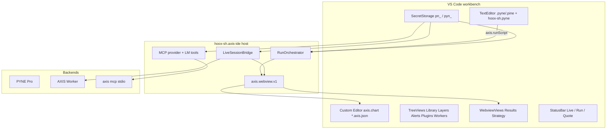

# Copyright (c) 2026 HOOX · AXIS · hoox-sh (jango_blockchained)
#
# This file is part of axis.
#
# axis is free software: you can redistribute it and/or modify
# it under the terms of the GNU Affero General Public License as published by
# the Free Software Foundation, version 3 of the License only.
#
# axis is distributed in the hope that it is useful,
# but WITHOUT ANY WARRANTY; without even the implied warranty of
# MERCHANTABILITY or FITNESS FOR A PARTICULAR PURPOSE.  See the
# GNU Affero General Public License for more details.
#
# You should have received a copy of the GNU Affero General Public License
# along with axis.  If not, see <https://www.gnu.org/licenses/>.
#
# SPDX-License-Identifier: AGPL-3.0-only

---
title: AXIS VS Code Extension (AXIS IDE) — plan
description: Condensed authoritative plan for hoox-sh.axis-ide + hoox-sh.axis-pack pack. Locked decisions KD-1..KD-15, architecture, packaging, security, testing gates, phasing P0–P6, and PR map. Design run 118d12d1.
---

# AXIS VS Code Extension (AXIS IDE) — plan

> **Authoritative.** Full design: [`.opencode/plans/axis-vscode-extension-design.md`](./axis-vscode-extension-design.md) (run `118d12d1`).  
> Human tasklist: [`.opencode/plans/axis-vscode-extension-tasks.mdx`](./axis-vscode-extension-tasks.mdx).  
> Machine tracker: `.opencode/tmp/tasks/axis-vscode-ext/` (`task.json` + `subtask_01..27.json`).  
> Research briefs: [`.opencode/plans/axis-vscode-extension-research/`](./axis-vscode-extension-research/).

## 1. Objective

Ship **`hoox-sh.axis-ide`** as a native-first VS Code clone of the AXIS PWA chart / run / live / results / library / MCP surface, hard-dependent on **`hoox-sh.pyne`**, with SecretStorage keys and a Bun coverage ratchet. Optional one-click pack **`hoox-sh.axis-pack`**.

Non-negotiables:

- Pine edit stays on native `TextEditor` + PYNE LSP (no CodeMirror/Monaco embed, no LSP fork).
- Chart = `CustomEditorProvider` on `*.axis.json` from PR-04 (KD-4); Lightweight Charts Apache-2.0 only.
- Host owns run / live / secrets; webview owns LWC paint + drawing hit-testing.
- Live tickets via `GET /api/ws/live?issue=ticket` (not MCP bridge).
- Secrets never in `settings.json`; Worker keys `/^pn_[a-f0-9]{48}$/`.
- MCP soft-fail: `axis.mcp.allowNpx` default **false**; `resolveAxisCli` may return `null`.

## 2. Locked decisions (KD-1 … KD-15)

| # | Decision | Rationale |
| --- | --- | --- |
| KD-1 | Package under **`packages/vscode-axis-ide/`** (+ `packages/vscode-axis-pack/`) as sibling packages via `bun --cwd` — **not** npm/bun workspaces | Root has no `workspaces`; `bunfig.toml` already ignores `packages/**`. IDE semver independent of root `VERSION` / `sync-versions.mjs`. |
| KD-2 | Extension id **`hoox-sh.axis-ide`**, pack **`hoox-sh.axis-pack`** | Hard edge = `extensionDependencies: ["hoox-sh.pyne"]`; pack is soft one-click UX. |
| KD-3 | License **AGPL-3.0-only** (headers must not say “or later”) | Match AXIS SPDX/`NOTICE`. VSIX NOTICE must list Lightweight Charts Apache-2.0. Do not relicense PYNE. |
| KD-4 | **Native editor only** for Pine; chart = **`CustomEditorProvider`** on `*.axis.json` from PR-04 onward | No Readonly→Editable mid-flight; never default custom editor on `*.pyne`. |
| KD-5 | **Do not fork LSP**; `extensionDependencies` is **id-only**; recommend ≥0.5.4 | Electron test warns if installed PYNE older. |
| KD-6 | Host owns run/live/secrets; webview owns LWC paint | Default webview `connect-src 'none'` — host proxies network. |
| KD-7 | Typed protocol `axis.webview.v1`; adopt `vscode-messenger` only if multi-webview pain | Schema-version every message; zero extra runtime deps initially. |
| KD-8 | Secrets via **`ExtensionContext.secrets`**; never `pn_` / `pyn_` in settings | Worker keys `/^pn_[a-f0-9]{48}$/` (`WORKER_API_KEY_RE`). |
| KD-9 | MCP: `mcpServerDefinitionProviders` + `languageModelTools`; resolve `axis.mcp.command` → `which axis` → **only if** `axis.mcp.allowNpx` (default **false**) then npx → else **soft-fail** | Key only via env `AXIS_API_KEY`. Soft-fail reachable. |
| KD-10 | Phased chart reuse: P0–P1 mock LWC; P2+ import apply helpers; extract `@hoox-sh/axis-runtime` **only when 3rd consumer OR ≥5 duplicated modules** | Avoid premature package extraction (user-locked Q2). |
| KD-11 | `engines.vscode ^1.95.0`; `extensionKind: ["workspace"]` first; **web extension deferred indefinitely** | MCP provider + LM tools need newer floor than PYNE’s `^1.91.0` (user-locked Q3). |
| KD-12 | Dual-publish Marketplace + Open VSX | Cursor / Windsurf / VSCodium need Open VSX. |
| KD-13 | Unit tests = **`bun test`** (+ local coverage gate); integration = `@vscode/test-electron`; **no vitest** unless ADR | Matches `packages/cli` / root Bun culture. |
| KD-14 | Contribute inventory **grows with PRs** — Task 02 asserts **P0 only** | Appendices = 1.0 inventory. |
| KD-15 | Activation: **no `onStartupFinished`**; contribute-derived + `workspaceContains` + explicit commands/views/customEditor | MCP registers on first IDE activation; `axis.mcp.showConfig` activates for MCP-only users. |

## 2.1 Decisions on open questions

User-locked 2026-11-02 (design run `118d12d1`). Implement as stated; do not re-open.

| # | Decision |
| --- | --- |
| Q1 | **`axis.openChart` creates/updates a sibling `*.axis.json` next to the active `.pyne`/`.pine`** (e.g. `rsi.pyne` → `rsi.axis.json`). No untitled `axis:` scheme in v1. |
| Q2 | Extract `@hoox-sh/axis-runtime` only on **3rd consumer OR ≥5 duplicated modules** (KD-10). |
| Q3 | **Web extension deferred indefinitely** after desktop GA (KD-11). |
| Q4 | **Ship builtins JSON in the VSIX** (from `src/indicators/builtins`); no Worker fetch for builtins. |
| Q5 | **Omit** any `axis.secrets.importFromPyneSetting` / PYNE plaintext key import. SecretStorage via `axis.secrets.*` only. |
| Q6 | IDE VSIX ships assembled **NOTICE** including Lightweight Charts Apache-2.0 even if root `NOTICE` lags. |
| Q7 | Command ids use prefix **`axis.*`**. |
| Q8 | PYNE ≥0.5.4 is **README + electron warn only** — no hard-fail activation. |

## 3. Architecture

Full mermaid + sequences live in the design (§2 host↔webview↔engines, §7 run, §8 live). Summary:



- Live: mint `GET /api/ws/live?issue=ticket` → WS `?ticket=` (never MCP bridge; never `?key=`).
- History: mock/fixture through P1; **HistoryClient = Task 11 / PR-06b** for real OHLCV.
- Results focus: normative §7.1 in design (mirror `setLastRun`).

## 4. Packaging topology

```
packages/vscode-axis-ide/     # hoox-sh.axis-ide — host esbuild + Vite webviews
packages/vscode-axis-pack/    # hoox-sh.axis-pack — extensionPack only
```

| Bundle | Tool | Output |
| --- | --- | --- |
| Extension host | esbuild | `dist/extension.js` (`external: ['vscode']`) |
| Chart / Results webviews | Vite | `dist/webview/{chart,results}/` |
| IDE VSIX | `@vscode/vsce package --no-dependencies` | `axis-ide-<ver>.vsix` |
| Pack VSIX | vsce | `axis-pack-<ver>.vsix` |

Root scripts: `vscode:ide:compile|test|package` via `bun --cwd packages/vscode-axis-ide …`.

## 5. Native-first UI map (summary)

| PWA surface | VS Code mapping |
| --- | --- |
| Pine buffer | Native TextEditor + `hoox-sh.pyne` |
| Chart | Custom Editor `axis.chart` on `*.axis.json`; `axis.openChart` → **sibling** `*.axis.json` beside Pine (Q1) |
| Results / strategy | Panel WebviewViews `axis.results` / `axis.strategy` |
| Library / layers / scripts / alerts / plugins / workers | Activity-bar TreeViews |
| Watchlist + quote | TreeView `axis.watchlist` + StatusBar (**Task 20 / PR-08b**) |
| Logs | OutputChannels `AXIS Run` / `System` / `Script` |
| Secrets | Commands → SecretStorage (no config props for keys) |
| Studio settings | `contributes.configuration` `axis.*` |
| MCP | StatusBar + MCP Servers UI + LM tools |

P0 electron assert subset: commands `axis.showRunOutput`, `axis.openChart`; optional setting `axis.telemetry.offline` (KD-14).

## 6. Security & secrets model

- Slots: `axis.secret.cloud.apiKey` (`pn_`), `axis.secret.engine.server.apiKey` (`pyn_`), optional pyne-worker + git PAT.
- **No** PYNE plaintext key import command (Q5).
- Validate **before** store; status shows set/missing never the value; OutputChannel redacts keys/Bearers.
- Webview CSP: prefer paint-only (`connect-src 'none'`); host proxies fetch/WS.
- MCP: env `AXIS_API_KEY` only — never `--key` in long-lived configs.
- Dynamic URL plugins default off (`axis.plugins.allowUrlInstall: false`).

## 7. Testing gates

| Scope | BASELINE | TARGET |
| --- | --- | --- |
| Pure host (`src/host|protocol|secrets|run|live/**`) | Measured after PR-02; fail on regression | **90%** lines |
| Package overall (excl. vendor/LWC/dist) | Measured post-PR-04 | **80%** lines |
| Protocol codecs / round-trips | **100%** always | 100% |
| Electron inventory | P0 then grow (KD-14) | 1.0 Appendices A–C |

CI: `test:coverage:gate` + electron (+ xvfb) + `package` VSIX.

## 8. Phasing (P0–P6)

| Phase | Goal | Exit |
| --- | --- | --- |
| **P0** | Scaffold, activate (KD-15), PYNE dep, Output/StatusBar, P0 commands, Bun + electron harness | VSIX installs; Task 02 asserts P0 only |
| **P1** | CustomEditor chart shell + mock bars + Run → webview paint | Ctrl+Enter paints mock bars |
| **P1b** | HistoryClient + seriesKey + source/datafeed | Real OHLCV when mock flag off |
| **P2** | Results/Strategy + TreeViews + §7.1 focus | Focus rules unit-tested |
| **P3** | Live WS tickets + SecretStorage + HUD | Ticket path; status bar live |
| **P4** | Plugins + MVP drawings/alerts/watchlist | Registry; one drawing tool; alerts CRUD; watchlist+quote |
| **P5** | MCP soft-fail CLI resolve + LM tools + pack | Soft-fail missing binary; pack VSIX |
| **P6** | Perf/CSP + coverage ratchet + publish; optional Pyodide | BASELINE green; NOTICE lists LWC; Pyodide off by default |

Full drawings/alerts/library PWA parity → follow-on slug `axis-vscode-ext-parity`, not this 27-task track.

## 9. PR map (merge order)

| PR | Title (abbrev) | Depends on | Machine tasks |
| --- | --- | --- | --- |
| **PR-01** | Scaffold sibling package + P0 contributes + electron harness | — | 01, 02 |
| **PR-02** | `axis.webview.v1` codecs + coverage ratchet | PR-01 | 03, 04 |
| **PR-03** | SecretStorage `pn_`/`pyn_` (no settings secrets) | PR-01 | 05 |
| **PR-04** | `CustomEditorProvider` chart + Vite CSP shell | PR-01, PR-02 | 06 |
| **PR-05** | openChart sibling `*.axis.json` + mock OHLCV `chart.full` paint | PR-04 | 07, 08 |
| **PR-06** | RunOrchestrator + Pro `/run` (mock bars) | PR-03, PR-05 | 09, 10 |
| **PR-06b** | HistoryClient + seriesKey + datafeed/source | PR-06 | **11** |
| **PR-07** | Results/Strategy webviews + §7.1 focus | PR-06 | 12 |
| **PR-08** | Library / Layers / Scripts TreeViews (**no** watchlist) | PR-01 | 13, 14 |
| **PR-08b** | Watchlist + `displayedLastPrice` StatusBar | PR-08 | **20** |
| **PR-09** | LiveSessionBridge `/api/ws/live` tickets + HUD | PR-03, PR-06 | 15, 16 |
| **PR-10** | Plugins registry + Workers probe | PR-06 | 17 |
| **PR-11** | MVP drawing tool + MVP alerts | PR-04, PR-05, PR-08 | 18, 19 |
| **PR-12** | MCP provider + LM tools (KD-9 soft-fail) | PR-03, PR-06 | 21, 22 |
| **PR-13** | Extension pack `hoox-sh.axis` | PR-01 | 23 |
| **PR-14** | Coverage BASELINE CI + CSP/NOTICE + docs | PR-02…PR-12 | 24, 25, 26 |
| **PR-15** | Optional Pyodide calculator + CSP matrix update | PR-14 | 27 |

PR titles may keep letter suffixes (`PR-06b`, `PR-08b`); machine seqs are contiguous **`01`–`27`** only.

## 10. Pointers

| Artifact | Path |
| --- | --- |
| Full design | `.opencode/plans/axis-vscode-extension-design.md` |
| This plan | `.opencode/plans/axis-vscode-extension-plan.mdx` |
| Human tasklist | `.opencode/plans/axis-vscode-extension-tasks.mdx` |
| Machine JSON | `.opencode/tmp/tasks/axis-vscode-ext/` |
| Research | `.opencode/plans/axis-vscode-extension-research/` |

```bash
bash /mnt/data/home/jango/.opencode/skills/task-management/router.sh status axis-vscode-ext
bash /mnt/data/home/jango/.opencode/skills/task-management/router.sh next axis-vscode-ext
bash /mnt/data/home/jango/.opencode/skills/task-management/router.sh validate axis-vscode-ext
```
